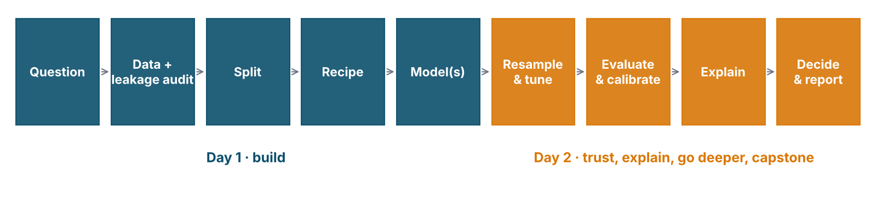
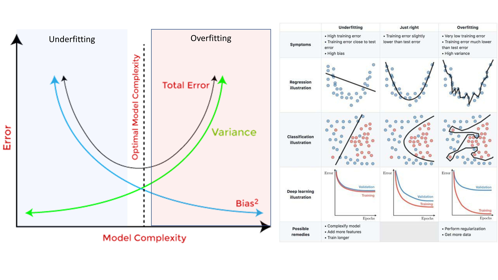
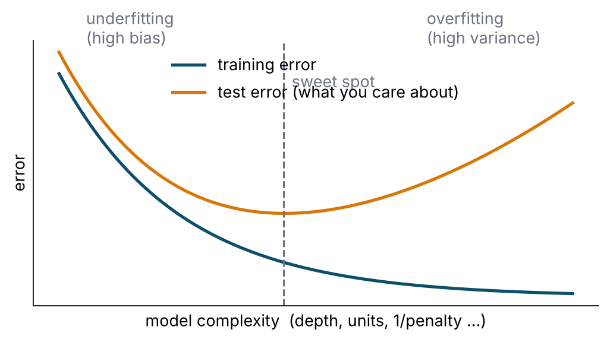
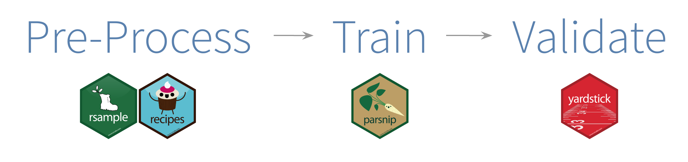
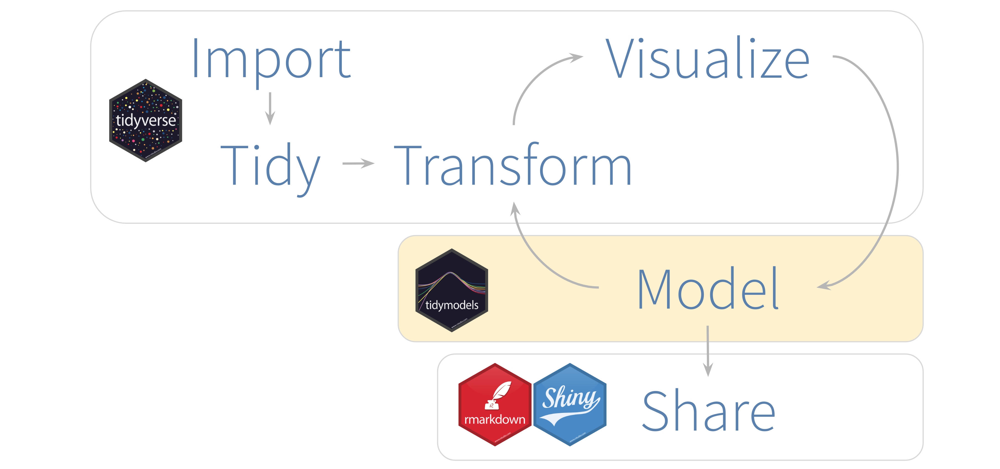

# Welcome {.section-slide .center background-color="#0b2545" background-gradient="linear-gradient(135deg, #0b2545 0%, #0f4c6e 55%, #13838f 100%)"}

## Who is in the room?

:::: {.columns}
::: {.column width="55%"}
Hands up — or type in the chat:

- Clinician · researcher · student · analyst · other?
- Have you fitted a **logistic regression** in R before?
- Have you fitted **any** machine-learning model before?
- Were you at last week's **Refresher Course**?
:::
::: {.column width="45%"}
::: {.key}
**Prerequisite:** you can read a `dplyr` pipe and a `ggplot`.
Everything else we build today.
:::
:::
::::

::: {.notes}
Calibrate the room. If >50% have never fitted a model, slow the Tutorial 1 live coding and cut the stretch goals. If many have used caret/mlr, point them to the tidymodels mapping slide.
:::

## What you will be able to do by 5 pm tomorrow

1. Explain the difference between a model that **explains** and a model that **predicts** — and validate each correctly.
2. Build a **leak-free pipeline** in `tidymodels`: split → recipe → workflow → resample.
3. Fit, compare and **tune** four model families — **random forests, support vector machines, XGBoost and neural networks** — against the logistic regression you already know.
4. Evaluate a classifier the way a **clinician** needs it evaluated — and choose a decision threshold on purpose.
5. **Explain** a model globally and locally, and know what the explanation does *not* mean.
6. Do all of it **yourself**: every session ends with you writing code, and every session has a self-guided tutorial you can redo at home.

## How the two days are built

{fig-align="center" width="100%"}

- **Every session: a short lecture → live coding → your turn.**
- Day 1 builds the pipeline and two model families. Day 2 adds the third, teaches you to validate, tune, evaluate and explain, and ends with neural networks.
- Materials: one **tutorial** per session (`tutorials/`) with everything we type, the outputs, the exercises and their solutions — the same pages will stay online.

## The agenda

:::: {.columns .agenda}
::: {.column width="50%"}
**Day 1 · Wednesday 11 Nov · *Build***

| Time | Session |
|------|---------|
| 09.00 | Welcome · **S1** Learning how the machine learns |
| 10.50 | **S2** The pipeline: split, recipe, workflow, leakage · *Tutorial 1* |
| 14.00 | **S3** Decision trees and random forests · *Tutorial 2* |
| 15.50 | **S4** Support vector machines · *Tutorial 3* |
:::
::: {.column width="50%"}
**Day 2 · Thursday 12 Nov · *Trust, then go deeper***

| Time | Session |
|------|---------|
| 09.15 | **S5** Gradient boosting and XGBoost · the bake-off · *Tutorial 4* |
| 10.50 | **S6** Resampling and tuning · *Tutorial 5* |
| 11.50 | **S7** Evaluation, calibration and explanation · *Tutorial 6* |
| 14.00 | **S8** Neural networks, parts 1 and 2 · *Tutorial 7* |
| 16.40 | Verdict · the reveal · where next |
:::
::::

Tea 10.30 and 15.30 · Lunch 13.00 · Minute-by-minute timings on the **Agenda** page of the workshop site (`agenda.qmd`).

## House rules

- **Type along** during demos. You will break things. That is the fastest way to learn the error messages.
- Stuck > 5 min → raise a hand. Helpers are here for exactly that.
- Pairs for the *Your turn* blocks.
- Phones: on. ChatGPT/Claude: allowed — **but you must be able to explain every line you paste.**
- Wi-Fi is for packages, not for Netflix. Everything should already be installed from `setup/`.

## The data

:::: {.columns}
::: {.column width="55%"}
`data/nhms_synthetic.csv` — 5,000 adults, 41 variables, NHMS-style.

- Sociodemographics, lifestyle, anthropometry, family history
- Clinic measurements: BP, random blood sugar, cholesterol
- Three outcomes: **undiagnosed** diabetes / hypertension / high cholesterol

**The question for both days:** who has undiagnosed diabetes?
**Take-home challenge:** who has undiagnosed hypertension?
:::
::: {.column width="45%"}
::: {.leak}
**It is synthetic.** Simulated from plausible Malaysian risk gradients so that the models have something real to find — and so that, at the end of Day 2, we can open the simulator and check what they found. No row is a person. No number is an estimate of anything.

Why not real NHMS data? It is confidential, and the usual way of de-identifying it (scrambling each column) destroys the relationships between variables that a model has to learn.
:::
:::
::::

::: {.notes}
Be upfront. Researchers respect it. Mention that the generator is in data-raw/ and we'll reveal the "truth" at the end of Day 2 — motivates the explainability section.
:::

# What is machine learning, really? {.section-slide .center background-color="#0b2545" background-gradient="linear-gradient(135deg, #0b2545 0%, #0f4c6e 55%, #13838f 100%)"}

## A model is a function fitted to data

$$\hat{y} = f(x_1, x_2, \dots, x_p)$$

- Logistic regression: $f$ is a sigmoid of a weighted sum. You fit it by maximum likelihood.
- A random forest: $f$ is an average of 500 decision trees. You fit it by greedy splitting.
- A neural network: $f$ is a stack of weighted sums and squashes. You fit it by gradient descent.

::: {.key}
**Statistics and machine learning are the same activity with different priorities.** ML optimises *predictive accuracy on new data* and lets the data choose the shape of $f$. Classical modelling optimises *interpretable, unbiased estimates of effects* and chooses the shape of $f$ by hand.
:::

::: {.notes}
Breiman's "Two Cultures" (2001). Shmueli "To explain or to predict?" (2010). This slide pre-empts the "it's just logistic regression" objection by agreeing with it.
:::

## Explain or predict? Two different jobs

| | **Explanatory** (classical epi) | **Predictive** (this workshop) |
|---|---|---|
| Question | Does smoking *cause* higher risk? | Who, in this population, has it *now*? |
| Hero statistic | Odds ratio with CI, p-value | AUC, calibration, sensitivity at a threshold |
| Variable selection | DAG, confounding, parsimony | Whatever is *available before the outcome* and improves prediction |
| Validation | Model assumptions, residuals | Performance on **unseen** data |
| Overfitting | A nuisance | **The central enemy** |
| Interactions, non-linearity | Added by hand, if theory says so | Learned from data |

::: {.good}
A predictor does **not** have to be causal to be useful. A causal effect does **not** have to predict well. Keep the two jobs apart in your head and in your paper.
:::

## The supervised-learning contract

:::: {.columns}
::: {.column width="55%"}
- You have **labelled examples**: $(x_i, y_i)$ for $i = 1 \dots n$.
- You want a rule that maps **new** $x$ → $y$.
- *Classification*: $y$ is a category (undiagnosed DM: yes/no).
- *Regression*: $y$ is a number (HbA1c, length of stay).

The machine "learns" by adjusting the rule until it is wrong as rarely as possible **on examples it has not seen**.
:::
::: {.column width="45%"}
Other kinds, not today:

- **Unsupervised**: no $y$ — clustering, dimension reduction (phenotypes, PCA).
- **Reinforcement**: learn by reward (dosing policies; mostly research).
- **Generative / LLMs**: learn to produce data; a story for another workshop.
:::
::::

## Vocabulary — same thing, several names

| In epidemiology | In machine learning | In `tidymodels` |
|---|---|---|
| exposure, covariate, independent variable | feature, input, predictor | `predictor` role |
| outcome, dependent variable | target, label, response | `outcome` role |
| estimation sample | **training set** | `training(split)` |
| validation sample | **test set** (held out, used once) | `testing(split)` |
| — | **validation / assessment set** (inside resampling) | `assessment(fold)` |
| coefficient | parameter, weight | learned by `fit()` |
| model settings (e.g. number of knots) | **hyperparameter** | `tune()` |
| fit the model | train, learn | `fit()`, `fit_resamples()` |
| apply the model | predict, score, infer | `predict()`, `augment()` |

## Where ML already works in health (and where it is oversold)

:::: {.columns}
::: {.column width="50%"}
**Working**

- Risk scores from routine data (readmission, deterioration, undiagnosed disease)
- Image reading: diabetic retinopathy, chest X-ray triage, pathology slides
- Signal reading: ECG, EEG, continuous monitoring
- Forecasting: dengue, COVID-19, HFMD, bed demand
- Text: coding, triage of referral letters
:::
::: {.column width="50%"}
**Oversold / failed in the wild**

- Models that never left the paper (no external validation)
- Models that learned the **hospital**, not the disease (shortcut learning)
- Models with AUC 0.95 because the answer was in the inputs (**leakage** — today, 11.15)
- Models calibrated in one population and deployed in another
- "Accuracy 94%" at 6% prevalence
:::
::::

::: {.notes}
Use your own dengue/COVID forecasting work here if you want a personal anchor. The Epic sepsis model (Wong et al. 2021, JAMA IM) is the canonical cautionary tale.
:::

## The lifecycle of a predictive model

1. **Question** — for whom, deciding what, with what information available *at that moment*?
2. **Data** — assemble, clean, audit for leakage
3. **Split** — lock away a test set
4. **Pre-process** — a recipe, estimated on training data only
5. **Train** — one or several model families
6. **Validate** — resampling, honest estimates with error bars
7. **Tune** — search hyperparameters, on resamples
8. **Evaluate** — on the test set, once; discrimination *and* calibration
9. **Explain** — importance, dependence, SHAP; sanity-check against domain knowledge
10. **Decide** — threshold, decision rule, report (TRIPOD+AI)
11. **Deploy & monitor** — drift, recalibration, fairness

Day 1 = steps 1–5. Day 2 = steps 6–10. Step 11 = the last slide tomorrow.

# The one idea that matters: bias and variance {.section-slide .center background-color="#0b2545" background-gradient="linear-gradient(135deg, #0b2545 0%, #0f4c6e 55%, #13838f 100%)"}

## Underfitting and overfitting

{fig-align="center" height="520"}

::: {.credit}
Tassopoulou 2019; Kaggle blog 2020
:::

## The curve that explains every hyperparameter

{fig-align="center" height="440"}

- **High bias**: the model is too simple to capture the signal — bad on training *and* test data.
- **High variance**: the model memorised the training data's noise — great on training, bad on test.
- Every tuning knob you meet (tree depth, `mtry`, penalty, hidden units, cost, k) moves you along this x-axis.

## The one rule

::: {.key}
### Never evaluate a model on the data it was trained on.

Training error always goes down as the model gets more flexible. It tells you nothing about new patients. Every honest number in this workshop comes from data the model did not see: a held-out fold or the locked test set.
:::

Corollaries you will see today:

- A single train/test split is a **noisy** estimate → resample (Day 2, 9.15).
- Anything estimated from data (imputation medians, scaling, SMOTE) must be estimated **inside** the training fold → recipes.
- If it looks too good, it probably **is**: suspect leakage before celebrating.

# tidymodels: one grammar for every model {.section-slide .center background-color="#0b2545" background-gradient="linear-gradient(135deg, #0b2545 0%, #0f4c6e 55%, #13838f 100%)"}

## Why not just call `xgboost()`?

You can. Then `ranger()` wants a formula, `xgboost()` wants a matrix, `kernlab` wants scaled numerics, every package returns `predict()` output in a different shape, and the confusion-matrix code gets copy-pasted four times with four different bugs.

:::: {.columns}
::: {.column width="55%"}
**tidymodels** gives you:

- one way to **split** (`rsample`)
- one way to **pre-process** (`recipes`)
- one way to **specify** a model and swap the engine (`parsnip`)
- one object that **bundles** both (`workflows`)
- one way to **resample & tune** (`tune`, `dials`, `finetune`)
- one way to **measure** (`yardstick`, `probably`)
- one way to **compare many** (`workflowsets`)
:::
::: {.column width="45%"}

:::
::::

## The map

{fig-align="center" height="420"}

Model → *validate* → *tune* → *evaluate* → *communicate*. Same loop as R4DS, with resampling inside "Model".

::: {.credit}
R for Data Science, 2e
:::

## Anatomy of a parsnip model

```{r}
rand_forest(mtry = 6, trees = 500, min_n = 10) |>   # 1. model TYPE and its main hyperparameters
  set_engine("ranger") |>                            # 2. which PACKAGE actually fits it
  set_mode("classification")                         # 3. classification or regression
```

- The **type** names the method in a package-agnostic way: `logistic_reg()`, `decision_tree()`, `rand_forest()`, `boost_tree()`, `svm_rbf()`, `mlp()`.
- The **engine** is the implementation: `"glm"`, `"glmnet"`, `"ranger"`, `"xgboost"`, `"kernlab"`, `"nnet"`, `"brulee"`.
- The **main arguments** have the same names across engines (`mtry` is `mtry` whether ranger calls it `mtry` or xgboost calls it `colsample_bynode`).
- Engine-specific extras go in `set_engine("ranger", importance = "permutation")`.

Nothing is fitted yet. A specification is a plan.

## The pipeline in six verbs

```{r}
dm_split <- initial_split(dm_data, prop = 0.8, strata = undx_dm)        # 1. split
dm_rec   <- recipe(undx_dm ~ ., data = training(dm_split)) |>            # 2. recipe
  step_impute_median(all_numeric_predictors()) |>
  step_dummy(all_nominal_predictors()) |>
  step_normalize(all_numeric_predictors())
lr_wf    <- workflow(dm_rec, logistic_reg() |> set_engine("glm"))        # 3. workflow
lr_res   <- fit_resamples(lr_wf, vfold_cv(training(dm_split), v = 5))   # 4. resample
collect_metrics(lr_res)                                                  #    honest estimate
lr_last  <- last_fit(lr_wf, dm_split)                                    # 5. fit on train, score test ONCE
collect_metrics(lr_last)                                                 # 6. report
```

::: {.say}
Twenty lines. By 11.50 you will have typed every one of them. By tomorrow 10.30 you will add `tune()` between steps 3 and 4 and nothing else changes.
:::

## If you learned tidymodels a few years ago — what changed

| Then | Now |
|---|---|
| `%>%` | `|>` (native pipe; either works) |
| `select_best(res, "roc_auc")` | `select_best(res, metric = "roc_auc")` — positional is an **error** in tune ≥ 2.0 |
| `doParallel::registerDoParallel()` | `library(future); plan(multisession)` — foreach is **no longer supported** |
| `grid_latin_hypercube()` | `grid_space_filling()` (old name still works) |
| `step_string2factor()` | convert to factors with `mutate()` before the split |
| `finalize_model()` + rebuild workflow | `finalize_workflow()` |
| copy-paste four model blocks | `workflow_set()` + `workflow_map()` |
| only `shapviz` on xgboost | `kernelshap` + `shapviz` on **any** model; `DALEXtra` for PDP/importance |
| — | `probably` for calibration and thresholds; `finetune` for racing |

## What "good" looks like when you write it up

- **TRIPOD+AI** (Collins et al., *BMJ* 2024): the reporting checklist for prediction models — participants, predictors (and when they were available), outcome, sample size, missing data, model building, **performance with calibration**, fairness, code & data availability.
- **PROBAST+AI**: risk-of-bias assessment; most published models fail on *analysis* (leakage, no calibration, optimistic validation).

::: {.key}
We will tick TRIPOD+AI items as we go. If an item sounds like bureaucracy, it is usually the scar tissue of a model that hurt someone.
:::

## Next: Tutorial 1 (10.50)

- Clean the codes (`-9` is not a number)
- Split with strata
- Write a recipe and look inside it
- Fit a logistic baseline through a workflow
- Watch the AUC come out at **0.98** — and find out why that is bad news

::: {.say}
Tea. Back at 10.50 with RStudio open on `tutorials/01_pipeline.qmd`.
:::
