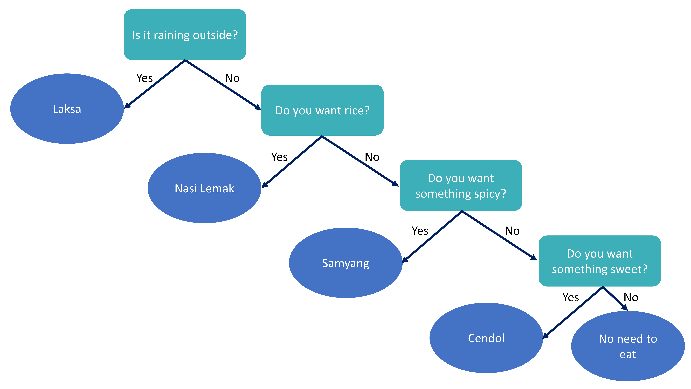
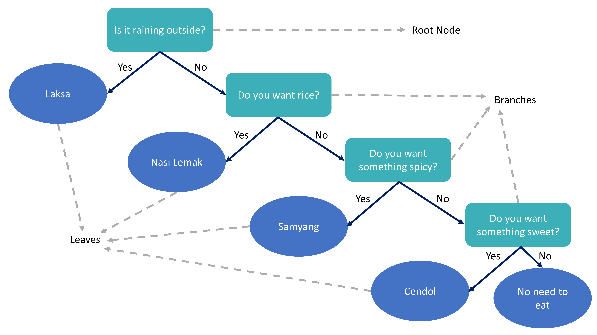
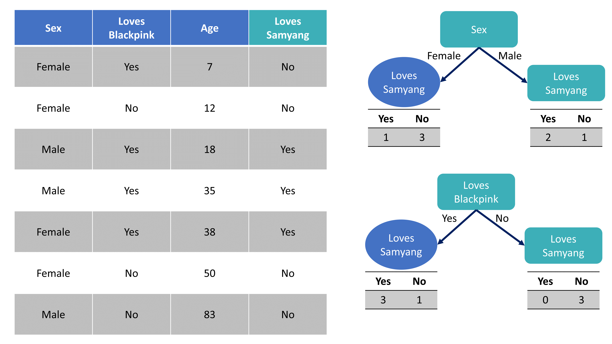
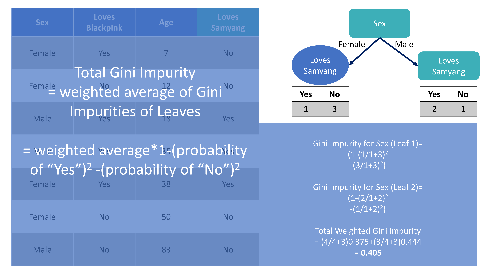
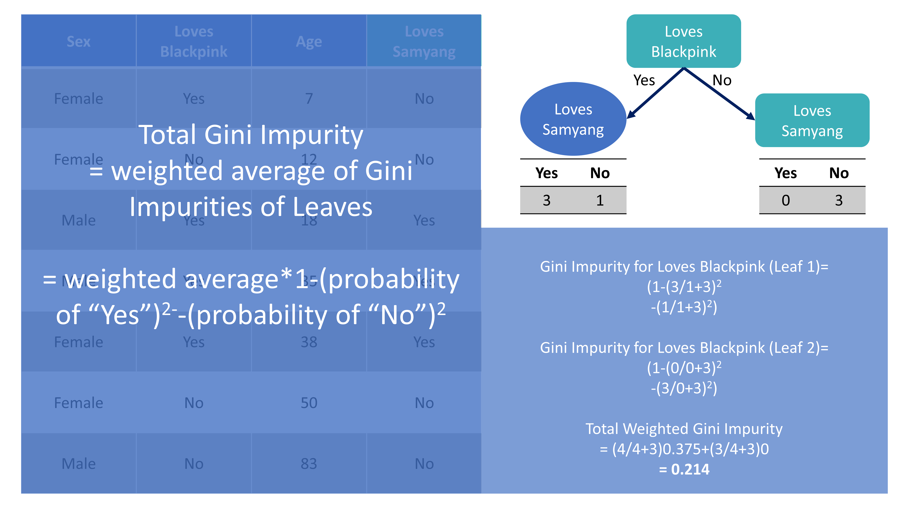
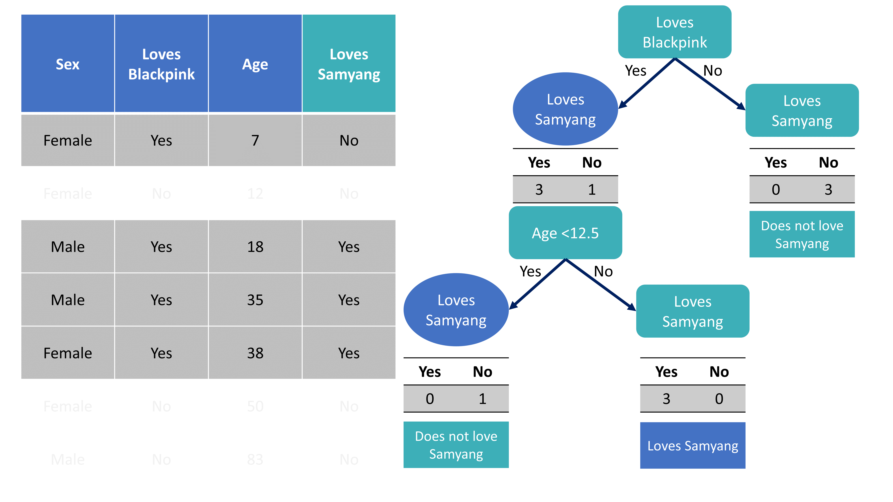
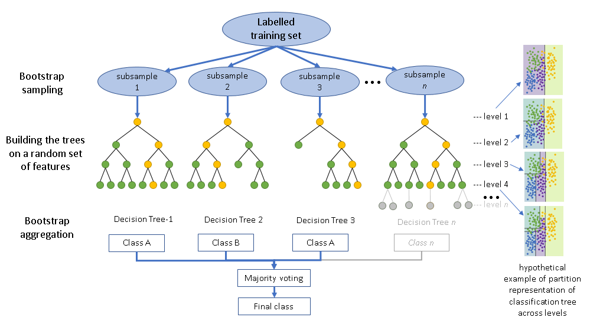

## Four families, two days

> *Learn a classifier from labelled instances so as to predict labels for unseen instances.*

This morning the classifier was a straight line in logit space. From now on we let the data bend it.

| Family | Idea | When |
|---|---|---|
| Logistic regression | weighted sum → sigmoid | the baseline (done) |
| **Random forest** | ask yes/no questions; average hundreds of trees | **now** |
| **Support vector machine** | the widest street between the classes; kernels bend it | 15.50 |
| **XGBoost** | trees built in sequence, each fixing the last one's errors | tomorrow 09.15 |
| **Neural network** | stacks of weighted sums and squashes, trained by gradient descent | tomorrow 14.00 |

# Decision trees {.section-slide .center background-color="#0b2545" background-gradient="linear-gradient(135deg, #0b2545 0%, #0f4c6e 55%, #13838f 100%)"}

## A very Malaysian decision tree

{fig-align="center" height="500"}

::: {.credit}
Adapted from StatQuest (J. Starmer, 2019)
:::

## The parts of a tree

{fig-align="center" height="500"}

- **Classification tree**: leaves hold a class and a proportion (→ a probability).
- **Regression tree**: leaves hold a mean.

## Which question goes at the top? Gini impurity

$$\text{Gini}(\text{node}) = 1 - \sum_k p_k^2 \qquad\text{(0 = pure; 0.5 = a coin toss for two classes)}$$

For each candidate split compute the **weighted average Gini of the two children**; the lowest wins. Repeat inside
each child. Stop when nothing improves, or when a stopping rule says so.

:::: {.columns}
::: {.column width="50%"}

:::
::: {.column width="50%"}

:::
::::

::: {.credit}
Adapted from StatQuest (2019)
:::

## Comparing candidates — and continuous predictors

:::: {.columns}
::: {.column width="50%"}

:::
::: {.column width="50%"}
For a **continuous** predictor: sort the values, take the midpoint between each adjacent pair as a candidate
threshold, compute the Gini for each, keep the best.

That is why trees find **cut-offs** (BMI ≥ 27.5, waist ≥ 80 cm) nobody told them about — and why a tree's
prediction surface is a **staircase**, never a slope.

Entropy / information gain: same idea with a log instead of a square. It rarely matters which.
:::
::::

## Growing until pure — and the problem with that

{fig-align="center" height="400"}

The leaf "age < 12.5" holds **one** person. The tree is now confident about a sample of one. That is overfitting,
in a picture.

::: {.credit}
Adapted from StatQuest (2019)
:::

## Keeping a tree honest

| Lever | `decision_tree()` | Effect |
|---|---|---|
| minimum people in a node before it may split | `min_n` | larger → simpler |
| maximum depth | `tree_depth` | smaller → simpler |
| cost-complexity pruning: a split must improve impurity by ≥ α | `cost_complexity` | larger → fewer leaves (CART's `cp`) |

```{r}
decision_tree(cost_complexity = 0.005, tree_depth = 4, min_n = 20) |>
  set_engine("rpart") |>
  set_mode("classification")
```

**Regression trees** work identically with the sum of squared residuals in place of Gini.

## Single trees: the honest verdict

:::: {.columns}
::: {.column width="50%"}
**For**

- Reads like a clinical algorithm
- Handles factors, skew and interactions with no pre-processing
- Fast; missing values via surrogate splits (rpart)
:::
::: {.column width="50%"}
**Against**

- **Unstable**: change a few rows, get a different tree
- **Inaccurate**: staircases approximate smooth truths badly
- Overfits unless pruned; pruning is a guess
:::
::::

::: {.key}
*"Trees have one aspect that prevents them from being the ideal tool for predictive learning, namely inaccuracy."*
— Hastie, Tibshirani & Friedman, *The Elements of Statistical Learning*

The fix: **don't grow one tree. Grow hundreds and combine them.** Two ways to combine → two families:
**bagging** (today) and **boosting** (tomorrow).
:::

# Random forests {.section-slide .center background-color="#0b2545" background-gradient="linear-gradient(135deg, #0b2545 0%, #0f4c6e 55%, #13838f 100%)"}

## Bagging: bootstrap + aggregate

1. Draw a **bootstrap sample** (n rows, with replacement) from the training data.
2. Grow a full, unpruned tree on it.
3. Repeat 500 times.
4. To predict: run the new person through all 500 trees and **vote** (classification) or **average** (regression).

Why it works: each tree is a noisy, high-variance estimate of the truth. **Averaging many noisy estimates cancels
the noise** (variance ↓) without adding bias — provided the trees are *different*. Hence the bootstrap.

About a third of rows are left out of each bootstrap sample → **out-of-bag (OOB)** rows → a free validation set
for every tree → the **OOB error** is an honest estimate you get without cross-validation.

## Random forests = bagging + a twist

{fig-align="center" height="330"}

**The twist:** at **each split** a tree may only consider a random subset of `mtry` predictors (default ≈ √p).

Without it every bootstrap tree would put the same dominant predictor (age) at the root and the trees would be
highly correlated — and averaging correlated things does not reduce variance much. Random feature subsets
**decorrelate** the trees.

::: {.credit}
Catalyst Earth (2023)
:::

## The three knobs

| | Meaning | Heuristic | Bias–variance |
|---|---|---|---|
| `mtry` | predictors considered at each split | √p (classification), p/3 (regression) | ↑ → trees more alike; lower bias, higher correlation |
| `trees` | number of trees | 500–1000; more never *hurts*, only costs time | more → lower variance, until it plateaus |
| `min_n` | minimum node size | 5–10 for classification; larger smooths probabilities | ↑ → simpler trees, more bias, less variance |

```{r}
rand_forest(mtry = 6, trees = 500, min_n = 10) |>
  set_engine("ranger", importance = "permutation", seed = 2026) |>
  set_mode("classification")
```

::: {.say}
Heuristics are starting points. Tomorrow cross-validation chooses. In practice random forests are forgiving:
defaults are usually within 0.01 AUC of tuned.
:::

## What a forest can tell you about the variables

- **Impurity importance** (how much a variable reduced Gini, summed over all splits): fast; **biased** toward
  continuous and many-level predictors.
- **Permutation importance** (shuffle a column in the OOB data; see how much error rises): slower; fairer;
  **correlated predictors share credit** (waist and BMI each look weaker than they are).

```{r}
rf_fit |> extract_fit_engine() |> ranger::importance() |> tibble::enframe("variable", "importance") |> arrange(desc(importance))
```

Importance says **which**. It does not say **how** (direction, shape) — that is tomorrow (PDP, SHAP).

## Where forests win, and where they don't

**Win**: tabular data with mixed types, interactions, thresholds; moderate n; little time to tune; a strong,
honest baseline for almost any health prediction problem.

**Don't**:

- **Extrapolation** — a tree cannot predict outside the range it saw (a 110-year-old gets the 92-year-old's leaf).
- **Smooth additive truths** — a GLM with the right spline beats a staircase.
- **Calibration** — forest probabilities are pulled toward the middle (few 0.05s, few 0.95s); recalibrate before
  showing them to a patient.
- **Raw signals** (images, waveforms, text) — neural networks' home turf.

## → Tutorial 2 (`tutorials/02_random_forests.qmd`)

1. One tree, pruned vs unpruned — the overfitting signature in two numbers
2. A random forest, resampled on the five folds; OOB error; permutation importance
3. Forest vs logistic baseline, with error bars
4. **Your turn:** the five-minute forest — four settings, compared on the folds; forest vs GLM — do they see the same world?

::: {.say}
Then tea, then support vector machines.
:::
