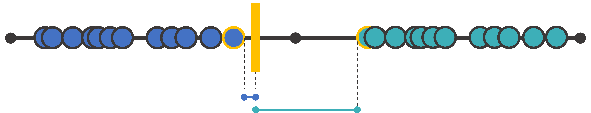
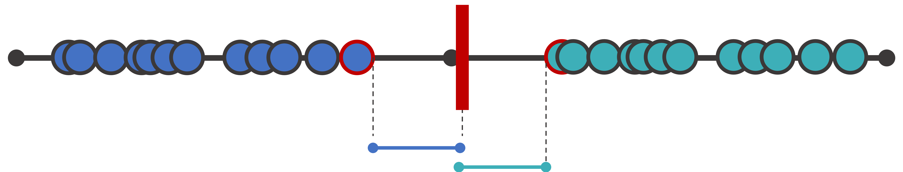
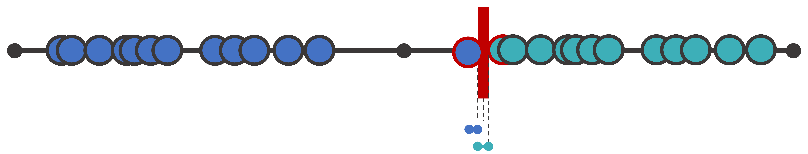
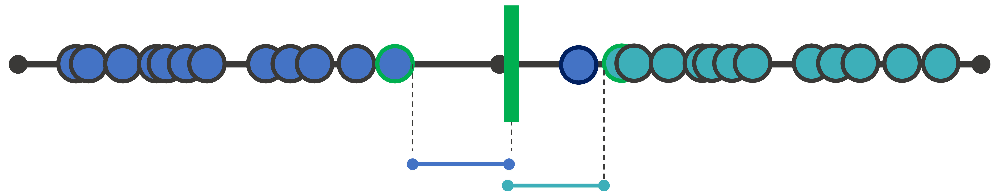
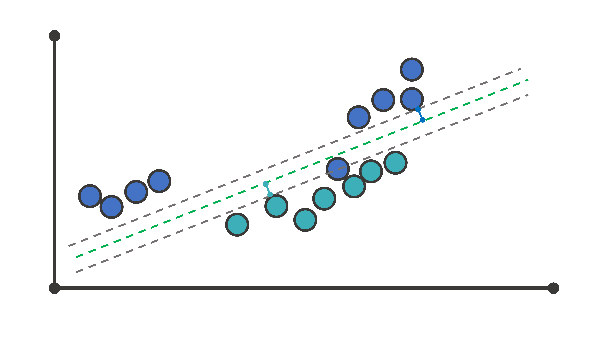
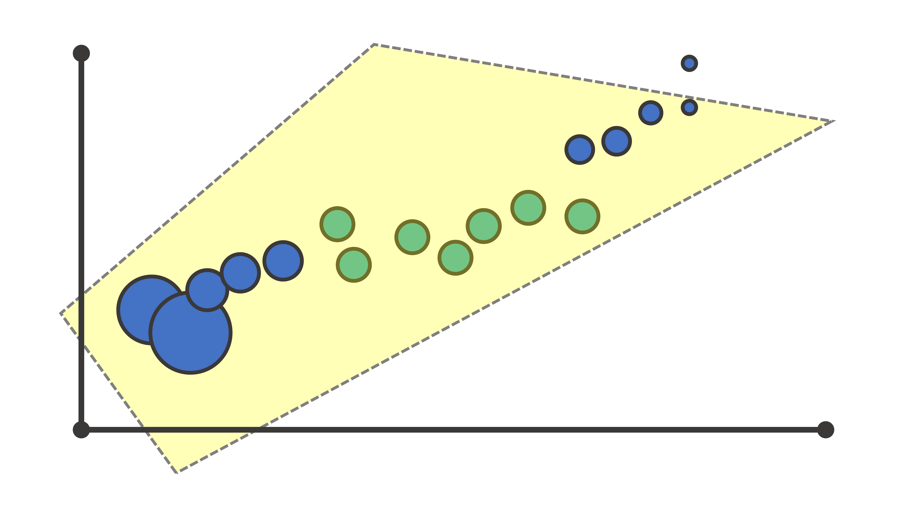
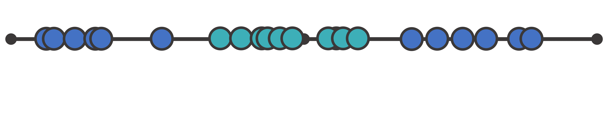
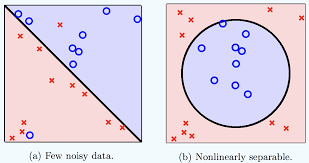
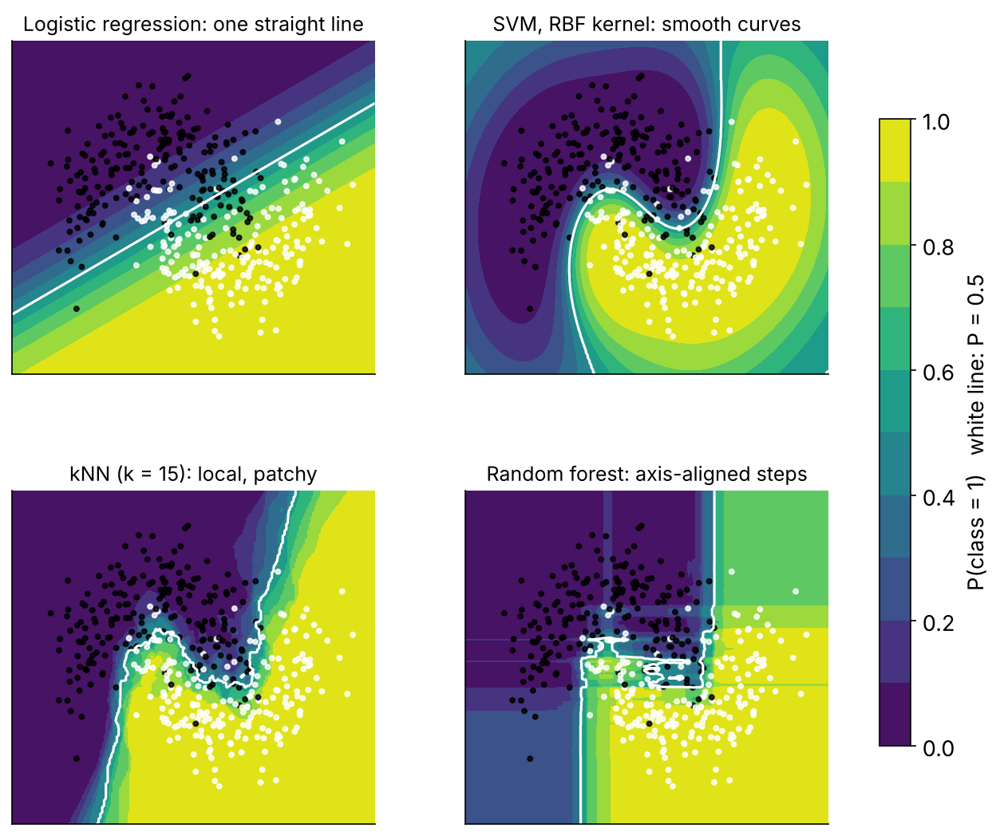

## Start with one variable: where do you put the line?

:::: {.columns}
::: {.column width="50%"}


A **threshold** classifies. A point just over it is called "spicy" even though it looks like the "not spicy" group.
:::
::: {.column width="50%"}


**Maximal margin**: put the threshold halfway between the closest members of each class — as far from both as
possible.
:::
::::

::: {.credit}
Adapted from StatQuest (J. Starmer, 2019)
:::

## Outliers break hard margins → soft margins

:::: {.columns}
::: {.column width="50%"}


One outlier drags the maximal margin into a terrible place.
:::
::: {.column width="50%"}


**Soft margin**: allow some points inside the margin, or on the wrong side, in exchange for a wider, more robust
street. How many? Chosen by cross-validation → the `cost` parameter.
:::
::::

A soft-margin classifier is a **support vector classifier**. The *support vectors* are the few points that touch or
cross the margin — the only ones that determine the boundary.

## Two dimensions, three dimensions, p dimensions

:::: {.columns}
::: {.column width="50%"}

:::
::: {.column width="50%"}

:::
::::

A line in 2-D, a plane in 3-D, a **hyperplane** in p-D. Same maths. Still straight.

## When a straight street cannot work: kernels

:::: {.columns}
::: {.column width="45%"}


No threshold on this axis separates the classes.
:::
::: {.column width="55%"}
**The kernel idea**

1. Start in low dimension.
2. Map the data into a **higher** dimension (e.g. add $x^2$).
3. Find a straight hyperplane there.
4. Project back: the boundary is **curved** in the original space.

**The kernel trick**: you never compute the high-dimensional coordinates — only similarities between pairs of
points — so even infinite dimensions are affordable.
:::
::::

## Two kernels you will use

:::: {.columns}
::: {.column width="55%"}
**Polynomial** — `svm_poly(cost, degree)`
Boundary = polynomial curve. `degree` 1 = linear; 2–3 = gentle curves; higher = wiggly, overfits.

**Radial basis function (RBF)** — `svm_rbf(cost, rbf_sigma)`
Similarity decays with distance like a Gaussian bump around each support vector → boundaries that can enclose
islands. `rbf_sigma`: large = narrow bumps = wiggly; small = wide bumps = smooth.
:::
::: {.column width="45%"}

:::
::::

::: {.credit}
Zhou (2017)
:::

## What the boundary looks like

{fig-align="center" height="480"}

A toy problem. On our `age × bmi` the pictures are far less dramatic — which is itself the finding: the risk surface
is close to additive.

## SVM in practice

```{r}
svm_rbf(cost = 1, rbf_sigma = 0.005) |>
  set_engine("kernlab") |>
  set_mode("classification")
```

| | |
|---|---|
| `cost` | penalty for margin violations. **High** → narrow margin, fits training data, overfits. **Low** → wide margin, underfits. Tune on a log₂ scale. |
| `rbf_sigma` / `degree` | boundary flexibility. Tune on a log₁₀ scale. |
| Pre-processing | **numeric, scaled** — mandatory. `dm_rec` does both. (kernlab also rescales internally by default — other engines don't; keep it in the recipe.) |
| Probabilities | not native; `kernlab` fits a logistic on the decision values ("Platt scaling") — slower, calibration so-so |
| Cost | roughly O(n²): fine at 4,000 rows, painful at 400,000 |
| Interpretability | low: no coefficients (except linear), no trees, no importances without model-agnostic tools |

## Where SVMs fit today

- State of the art for tabular data roughly 1995–2010; gradient boosting took that title, deep learning took
  images and text.
- Still excellent for **small, high-dimensional, clean** problems: gene-expression panels, text classification,
  some signal problems.
- The margin idea underpins a lot of later theory (regularisation as margin maximisation; kernel methods generally).
- For survey-type health data you will rarely choose one over XGBoost — but you should be able to fit, tune and
  explain one when a reviewer asks.

## → Tutorial 3 (`tutorials/03_svm.qmd`)

1. Linear, polynomial and RBF kernels through the same workflow
2. What kernlab returns: support vectors, the Platt probability model
3. Honest comparison on the five folds — and why it is slower than the forest
4. **Your turn:** cost vs overfitting (training AUC vs CV AUC); what happens without scaling

::: {.say}
17.00: Day 1 wrap. Tomorrow 09.15: XGBoost, and the bake-off of all four.
:::
