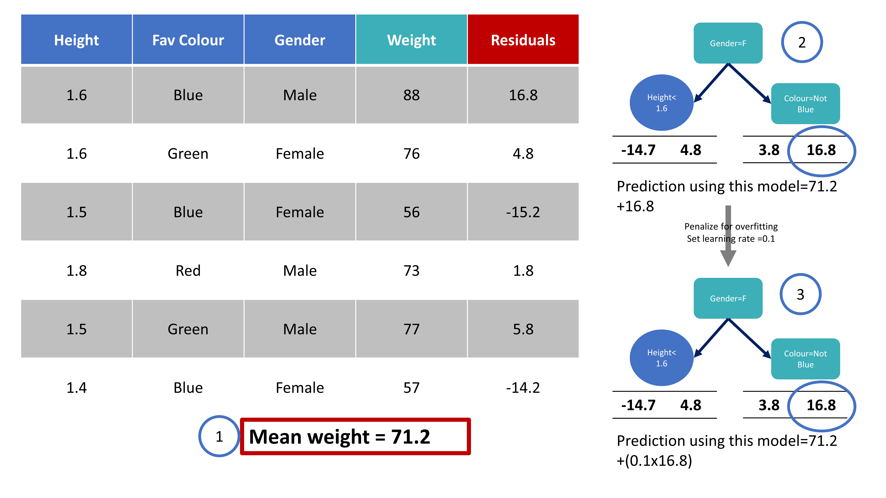
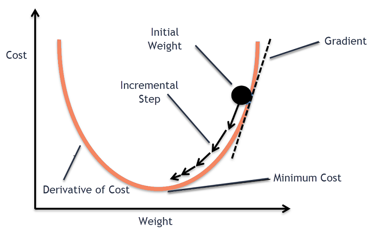
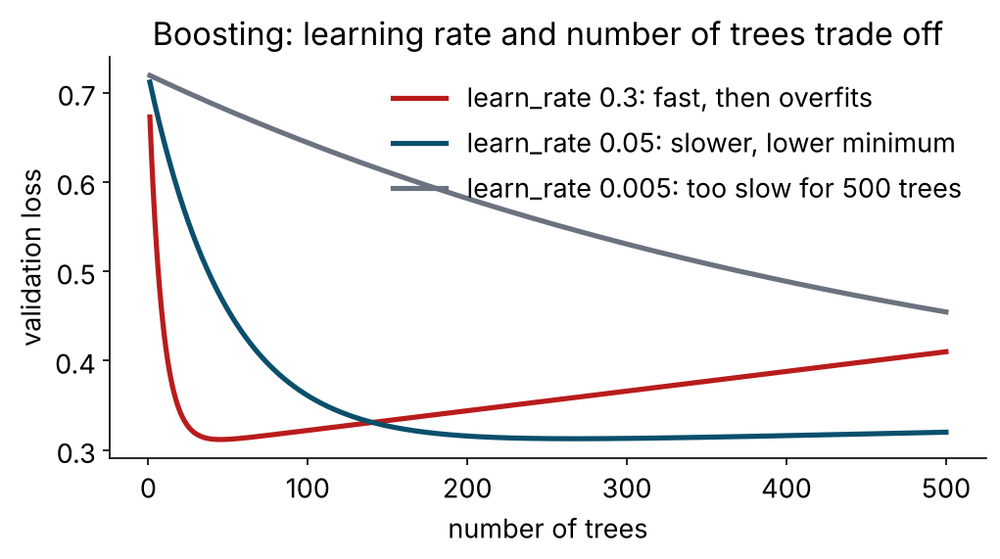

## Two ways to combine trees

| | Bagging (random forest, yesterday) | Boosting (today) |
|---|---|---|
| Trees are | deep, **independent**, grown in parallel | shallow, **sequential**, each fixes the last |
| Reduces mainly | variance | bias (and variance via shrinkage and subsampling) |
| Combines by | voting / averaging | adding, with a learning rate |
| Overfits when | rarely — more trees never hurt | too many rounds, high learning rate, deep trees |
| Tuning sensitivity | low | **high** |
| Typical tabular ranking | very good | **best in class, when tuned** |

# Boosting {.section-slide .center background-color="#0b2545" background-gradient="linear-gradient(135deg, #0b2545 0%, #0f4c6e 55%, #13838f 100%)"}

## Fix the previous model's mistakes

{fig-align="center" height="330"}

1. Start with a trivial prediction — the log-odds of the prevalence.
2. Compute, for every person, how wrong and in which direction.
3. Fit a **small** tree (depth 1–6) to those errors.
4. Add it to the ensemble, shrunk by a **learning rate** (0.01–0.3).
5. Repeat for hundreds of rounds.

::: {.credit}
Adapted from StatQuest (2019)
:::

## Why "gradient"?

{fig-align="center" height="300"}

"How wrong, in which direction" is the **gradient of the loss** with respect to the current prediction. For
log-loss and a probability output that gradient is simply *observed − predicted*. Each new tree is a step
**downhill on the loss function**; the learning rate is the step size. **Gradient descent in the space of
trees** — the same idea trains neural networks this afternoon, with weights instead of trees.

::: {.credit}
Hikmat et al. (2021)
:::

## Learning rate and number of trees trade off

{fig-align="center" height="400"}

Small steps + many trees: slow, smooth, lower minimum. Big steps: fast, then **overshoots and overfits**.
Rule: fix a learning rate in 0.01–0.1, then let **early stopping** or cross-validation choose the number of
trees. Do not tune both freely.

## XGBoost: gradient boosting, engineered

| What | Why it matters |
|---|---|
| **Regularised objective** — λ on leaf weights, γ to prune splits whose gain is too small | less overfitting than plain GBM; the knobs `loss_reduction` (γ) and `penalty` (λ) |
| **Similarity score / gain** instead of Gini | splits chosen by how much they improve the *regularised* loss |
| **Approximate split finding** (weighted quantile sketch) | fast on large n |
| **Sparsity-aware splits** | learns a default direction for **missing values** — no imputation needed |
| **Row and column subsampling** | forest-style decorrelation inside boosting (`sample_size`, `mtry`) |
| **Parallel, cache-aware** | uses all your cores |

Cousins: **LightGBM** (leaf-wise growth, very fast; `bonsai`), **CatBoost** (ordered boosting, native categoricals).
Same ideas, different engineering.

## Regularisation in one slide (needed again at 14.00)

- **L2 (ridge, λ, "penalty")**: shrink all weights toward zero; none become exactly zero. Smoother, more stable.
- **L1 (lasso, "mixture = 1")**: shrink and **zero out** some weights — built-in variable selection.
- Toy-box analogy: L1 lets only a fixed number of toys in; L2 lets all of them in but packs them loosely.

Where you meet it: `glmnet` (`penalty`, `mixture`); XGBoost (λ, γ, `loss_reduction`); SVM (`cost` is 1/λ); neural
networks (weight decay).

**Regularisation = a deliberate bit of bias bought with a large drop in variance.**

## The seven knobs of `boost_tree()`

| Arg | xgboost name | Meaning | Start |
|---|---|---|---|
| `trees` | nrounds | boosting rounds | 500 with early stopping, or tune |
| `learn_rate` | eta | step size | 0.01–0.1 |
| `tree_depth` | max_depth | depth of each weak learner | 3–6 |
| `min_n` | min_child_weight | minimum (weighted) people per leaf | 10–30 |
| `loss_reduction` | gamma | minimum gain to split | 0–1 |
| `sample_size` | subsample | row fraction per tree | 0.7–1 |
| `mtry` | colsample_bynode | columns per split (`counts = FALSE` → proportion) | 0.5–1 |

```{r}
boost_tree(trees = 500, learn_rate = 0.03, tree_depth = 3, min_n = 20, sample_size = 0.8) |>
  set_engine("xgboost") |>
  set_mode("classification")
```

::: {.say}
XGBoost needs **numeric** predictors: the recipe must dummy-code factors. Scaling is irrelevant to trees but
harmless — so one recipe serves all four families.
:::

## Early stopping in tidymodels

```{r}
boost_tree(trees = 2000, learn_rate = 0.05, tree_depth = 3, stop_iter = 25) |>   # stop after 25 rounds without improvement
  set_engine("xgboost", validation = 0.2) |>                                       # on a 20% validation slice
  set_mode("classification")
```

- The evaluation log (validation log-loss per round) is stored on the fitted booster; Tutorial 4 plots it for
  three learning rates.
- Inside cross-validation the validation slice comes out of each *analysis* set, so nothing leaks.

# The bake-off {.section-slide .center background-color="#0b2545" background-gradient="linear-gradient(135deg, #0b2545 0%, #0f4c6e 55%, #13838f 100%)"}

## Four families, same folds, same recipe, one object

```{r}
model_zoo <- list(
  logistic = logistic_reg() |> set_engine("glm"),
  rf       = rand_forest(trees = 500, mtry = 6, min_n = 10) |> set_engine("ranger") |> set_mode("classification"),
  svm_rbf  = svm_rbf(cost = 1, rbf_sigma = 0.005) |> set_engine("kernlab") |> set_mode("classification"),
  xgb      = boost_tree(trees = 500, learn_rate = 0.03, tree_depth = 3, min_n = 20) |> set_engine("xgboost") |> set_mode("classification")
)

bakeoff_res <- workflow_set(preproc = list(base = dm_rec), models = model_zoo) |>
  workflow_map("fit_resamples", resamples = dm_folds, metrics = cls_metrics, seed = 2026)

rank_results(bakeoff_res, rank_metric = "roc_auc", select_best = TRUE)
autoplot(bakeoff_res, metric = c("roc_auc", "brier_class"))
```

- No copy-paste, no accidental test-set peeking. `preproc` can hold several recipes → every recipe × every model.
- After tea: `workflow_map("tune_race_anova", ...)` tunes them all the same way.

## Choosing is more than AUC

| Criterion | Logistic | Random forest | XGBoost | SVM |
|---|---|---|---|---|
| Discrimination on tabular data | good | very good | **best, tuned** | good |
| Calibration out of the box | **good** | fair (shrinks to the middle) | fair | poor (Platt) |
| Interpretability | **coefficients** | importance | importance | none |
| Training / prediction speed | **instant** | fast / slower | fast / fast | slow (n²) / fast |
| Handles missing natively | no | no (ranger) | **yes** | no |
| Tuning sensitivity | low | **low** | high | high |
| Deployable as a paper score | **yes** | no | no | no |

::: {.key}
If models are within one standard error, pick on calibration, interpretability, speed and deployability. On this
data that is usually logistic regression or a lightly tuned XGBoost — and the neural network this afternoon will
not change that ranking.
:::

## → Tutorial 4 (`tutorials/04_xgboost.qmd`)

1. Defaults vs a gentle setting — same algorithm, visible AUC gap
2. Early stopping: learning rate vs number of trees, three curves
3. XGBoost without imputation (native missing-value handling)
4. **The bake-off**: logistic, RF, SVM, XGBoost on the five folds; ranked with error bars
5. **Your turn:** the five-minute XGBoost — three settings of your own, on the folds; monotone constraints

::: {.say}
Then tea, then resampling and tuning.
:::
