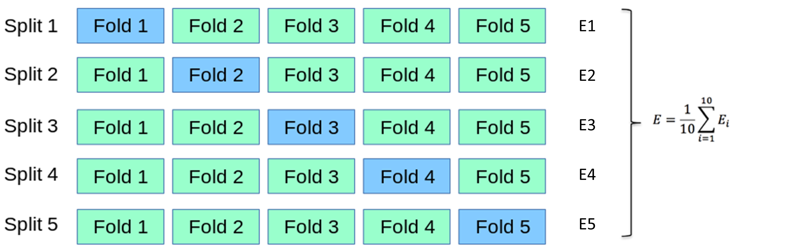
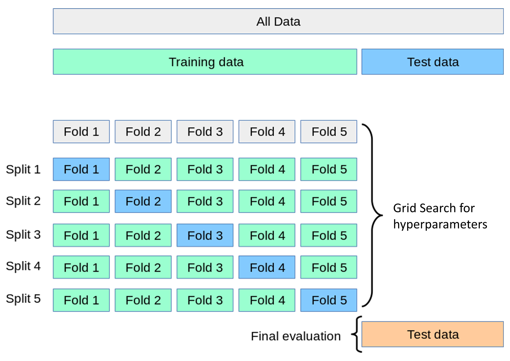
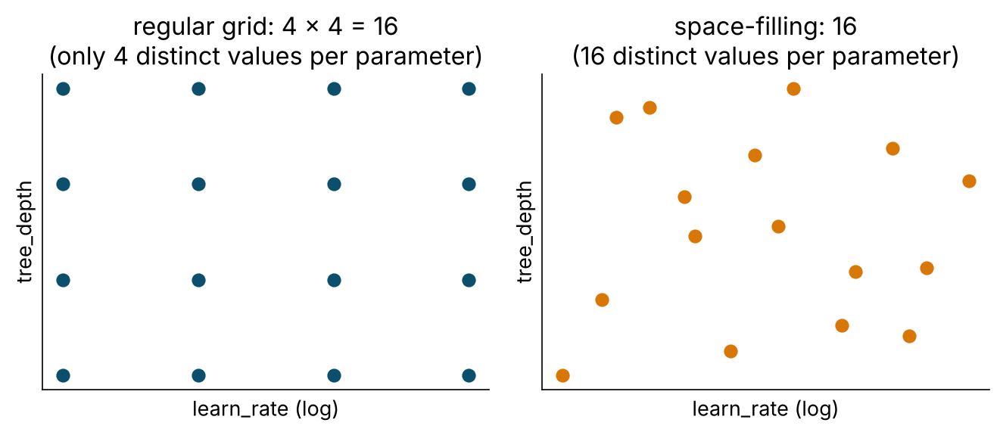

## This morning's bake-off, this hour's question

This morning you ranked four model families on five folds. Two questions were left hanging:

1. How much should we **trust** a number like "AUC 0.853"? (Resampling.)
2. Every model was run on **guessed** settings. What are the right ones? (Tuning.)

Both answers come from the same tool: fitting the model many times on data it has not seen.

# Why one split lies {.section-slide .center background-color="#0b2545" background-gradient="linear-gradient(135deg, #0b2545 0%, #0f4c6e 55%, #13838f 100%)"}

## The same model, 25 random splits

```{r}
many_splits <- mc_cv(dm_data, prop = 0.80, times = 25, strata = undx_dm)
lr_many     <- fit_resamples(lr_wf, many_splits, metrics = metric_set(roc_auc))
collect_metrics(lr_many, summarize = FALSE) |> ggplot(aes(.estimate)) + geom_histogram(bins = 12)
```

- Nothing changed except which 1,000 people were held out. Test AUC ranges from ~0.80 to ~0.88.
- Any single number in that range is a legitimate "test-set AUC". A paper that reports 0.88 is not lying — it is **reporting one draw from a distribution** and calling it the answer.
- With ~115 cases in a test set, that spread is unavoidable. Smaller test sets are worse.

::: {.key}
**Report mean ± standard error across resamples.** `collect_metrics()` gives you both. The SE is the number that tells you whether two models actually differ.
:::

## The resampling menu

| Scheme | `rsample` | How | Use when |
|---|---|---|---|
| **k-fold CV** | `vfold_cv(v = 10)` | k equal folds; each held out once | the default for comparison and tuning |
| **Repeated k-fold** | `vfold_cv(v = 10, repeats = 5)` | k-fold, shuffled r times | you can afford it; lowers variance of the estimate |
| **Stratified** | `strata = outcome` | folds keep class balance | **always**, for outcomes under ~30 % |
| **Monte-Carlo CV** | `mc_cv(times = 25)` | repeated random splits | quick variance check |
| **Bootstrap** | `bootstraps(times = 25)` | sample with replacement; OOB = assessment | small n; confidence intervals (`int_pctl()`) |
| **Leave-one-out** | `loo_cv()` | n folds | tiny n; high variance; rarely worth it |
| **Grouped** | `group_vfold_cv(group = patient_id)` | whole clusters held out together | repeated measures, multi-site |
| **Rolling origin** | `sliding_period()`, `rolling_origin()` | train on past, assess on future | time series, forecasting |
| **Validation set** | `initial_validation_split()` | one fixed assessment set | n in the millions; deep learning |
| **Nested CV** | outer `vfold_cv` + inner tuning | tune inside each outer fold | unbiased estimate of a *tuned* pipeline (see later) |

## k-fold, pictured

{fig-align="center" height="420"}

Five or ten? **10-fold** has less bias (90 % of data per fit); **5-fold** is twice as fast and fine for tuning big grids. We use 5 in the workshop for time; use 10 (repeated) in your paper.

::: {.credit}
Jian et al. (2022)
:::

## What happens inside one fold

```{r}
dm_folds$splits[[1]]
analysis(dm_folds$splits[[1]])      # 4/5 of the training set: recipe is prepped HERE, model fitted HERE
assessment(dm_folds$splits[[1]])    # 1/5: baked with the analysis set's medians/SDs, scored
```

- Imputation medians, scaling, dummy levels, SMOTE, feature selection — **everything estimated from data** is estimated on the analysis set only, five separate times.
- This is why pre-processing lives in a **recipe inside a workflow** and not in a `mutate()` before the split. A `mutate()` that uses the whole data set has already leaked.
- The same discipline applies to **variable selection**: selecting predictors on the full data and then cross-validating the model is the classic way to get an optimistic AUC (Ambroise & McLachlan 2002).

# Tuning {.section-slide .center background-color="#0b2545" background-gradient="linear-gradient(135deg, #0b2545 0%, #0f4c6e 55%, #13838f 100%)"}

## Parameters vs hyperparameters

- **Parameters** are learned from data by `fit()`: regression coefficients, split points, network weights.
- **Hyperparameters** are set *before* fitting and control how flexible the model may be: `mtry`, `min_n`, `tree_depth`, `learn_rate`, `penalty`, `cost`, `rbf_sigma`, `neighbors`, `hidden_units`, `epochs`.

Each hyperparameter is a position on the **bias–variance curve**. Tuning = finding the sweet spot **empirically, on resamples**.

```{r}
boost_tree(trees = 500, learn_rate = tune(), tree_depth = tune(), min_n = tune(), sample_size = tune())
```

`tune()` is a placeholder. The workflow still works; it just cannot be `fit()` until the placeholders are filled.

## Grid search

{fig-align="center" height="380"}

For each candidate setting → k-fold CV → average metric. Pick the best. Cost = candidates × folds model fits.

::: {.credit}
Jian et al. (2022)
:::

## Defining the search space: `dials`

```{r}
xgb_params <- extract_parameter_set_dials(xgb_tune_wf) |>
  update(
    learn_rate  = learn_rate(range = c(-2.5, -0.5)),   # log10 scale: 0.003 .. 0.32
    tree_depth  = tree_depth(range = c(2L, 8L)),
    min_n       = min_n(range = c(5L, 60L)),
    sample_size = sample_prop(range = c(0.5, 1))
  )
```

- Every tunable argument has a `dials` object with a default range and, where sensible, a **log transform** (`learn_rate`, `penalty`, `cost`, `rbf_sigma`, `loss_reduction`). Tune those on the log scale or you waste 90 % of the grid on one end.
- Defaults are deliberately wide. **Narrow them with domain sense** — a learning rate of 10⁻¹⁰ is not a candidate.
- Ranges that depend on the data (`mtry` ≤ number of predictors) need `finalize(mtry(), x = baked_predictors)` or an explicit `update()`.

## Regular vs space-filling grids

{fig-align="center" height="330"}

```{r}
grid_regular(xgb_params, levels = 3)              # 3^4 = 81 candidates, 3 distinct values each
grid_space_filling(xgb_params, size = 20)         # 20 candidates, 20 distinct values each
```

With 4+ parameters, a regular grid explodes and still only tries a few values per parameter. **Space-filling** (Latin hypercube / max-entropy) spreads a fixed budget evenly. `tune_grid(grid = 20)` builds one for you.

## Smarter than a grid

| Strategy | Function | Idea | When |
|---|---|---|---|
| Random search | `grid_random()` | sample candidates at random | cheap, surprisingly good |
| **Racing** | `finetune::tune_race_anova()` | after a few folds, drop candidates that are already significantly worse | **default choice**: same answer as a full grid at a fraction of the cost |
| Bayesian optimisation | `tune_bayes()` | fit a model of metric ~ hyperparameters, propose the next most promising candidate | expensive models, few evaluations |
| Simulated annealing | `finetune::tune_sim_anneal()` | local random walk that sometimes accepts worse moves | refining around a good region |

```{r}
xgb_race <- tune_race_anova(xgb_tune_wf, resamples = dm_folds, param_info = xgb_params, grid = 30,
                            metrics = metric_set(roc_auc, brier_class),
                            control = control_race(verbose_elim = TRUE))
plot_race(xgb_race)
```

## Reading the results

```{r}
collect_metrics(xgb_tuned)                  # mean, n, std_err for every candidate x metric
autoplot(xgb_tuned, metric = "roc_auc")     # one panel per parameter: flat = doesn't matter; slope/peak = does
show_best(xgb_tuned, metric = "roc_auc", n = 5)
```

Two ways to pick:

```{r}
select_best(xgb_tuned, metric = "roc_auc")                                    # the numerically best
select_by_one_std_err(xgb_tuned, metric = "roc_auc", tree_depth, desc(min_n))  # the SIMPLEST within 1 SE of best
```

::: {.key}
**The one-standard-error rule** (Breiman 1984): among candidates whose score is within one SE of the best, choose the simplest. Simpler = less overfit, faster, easier to explain, and the "best" was probably best by luck anyway.
:::

::: {.notes}
Remind: metric = must be named in tune ≥ 2.0. The sorting arguments of select_by_one_std_err define "simpler": smaller tree_depth, larger min_n.
:::

## Finalise, then — and only then — the test set

```{r}
xgb_final_wf <- finalize_workflow(xgb_tune_wf, select_best(xgb_race, metric = "roc_auc"))
xgb_last     <- last_fit(xgb_final_wf, split = dm_split, metrics = cls_metrics)

collect_metrics(xgb_last)          # test-set metrics, one shot
collect_predictions(xgb_last)      # test-set predictions, for curves and thresholds
extract_workflow(xgb_last)         # the fitted workflow: save it, deploy it
```

- `last_fit()` fits on **all** training data and predicts the test set in one call. It is the only function in the workshop that touches `dm_test`.
- If CV says 0.86 and the test says 0.80, something is wrong (leak in CV, distribution shift, bad luck with 115 cases). Investigate; do not re-tune on the test set.

## Parallel processing (it changed)

```{r}
library(future)
plan(multisession, workers = parallel::detectCores() - 1)   # that's it; tune/fit_resamples pick it up
```

- `tune` ≥ 1.3 uses the **future** (or mirai) framework. `doParallel::registerDoParallel()` from older tutorials **does nothing** now.
- Each worker needs memory for a copy of the data; on an 8 GB laptop stop at 3–4 workers.
- `ranger` and `xgboost` are multi-threaded themselves; parsnip pins them to 1 thread inside parallel tuning so they do not fight.
- Seeds: `set.seed()` before the call gives reproducible results, sequential or parallel.

## Nested cross-validation (when you need it)

Tuning on 5 folds and then reporting the best CV score is **slightly optimistic** — you picked the maximum of 20 noisy numbers.

- Usually small (0.005–0.01 AUC) and the locked **test set** catches it. That is its job.
- With small n, many candidates, or when there is no test set: **nested CV** — an outer loop of folds, and inside each outer analysis set a complete inner tuning. The outer assessment sets give an unbiased estimate of the *whole procedure*.
- Cost: outer × inner × candidates model fits. tidymodels supports it via `nested_cv()` and a little `purrr`; TMwR has a worked chapter.

::: {.say}
For a thesis: tune with repeated 10-fold, report the test set. For a methods paper or n < 500: nested CV.
:::

## Reporting what you did

TRIPOD+AI asks for, and reviewers increasingly check:

- resampling scheme (k, repeats, stratification), seeds
- which hyperparameters, what ranges, how searched, how selected (best vs 1-SE)
- the **CV estimate with SE** *and* the test estimate — and that the test set was used once
- performance **by subgroup** (sex, ethnicity, age band) — `collect_predictions() |> group_by(...) |> roc_auc(...)`
- confidence intervals: `int_pctl(xgb_last, metrics = cls_metrics)` bootstraps the test predictions

## → Tutorial 5 (`tutorials/05_tuning.qmd`)

**Live coding:** 25 random splits; the resampling menu; `tune()` + `dials`; grid vs space-filling; racing; the one-SE rule; `finalize_workflow()` → `last_fit()` — the test set, once.

**Your turn:** race-tune the random forest; apply the one-SE rule by hand; compare how many candidates survive vs XGBoost.
