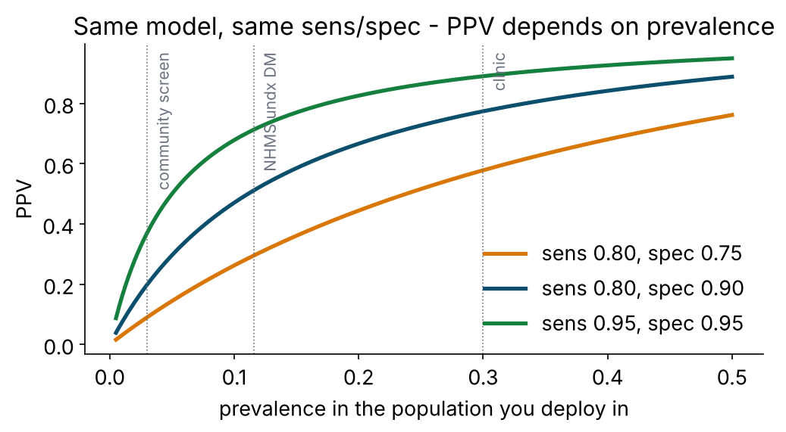
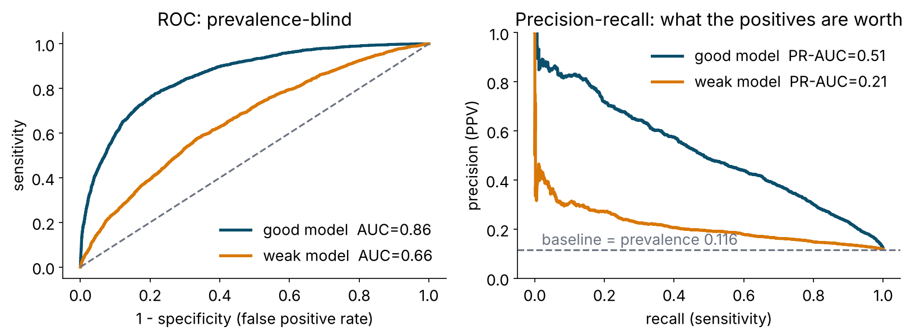
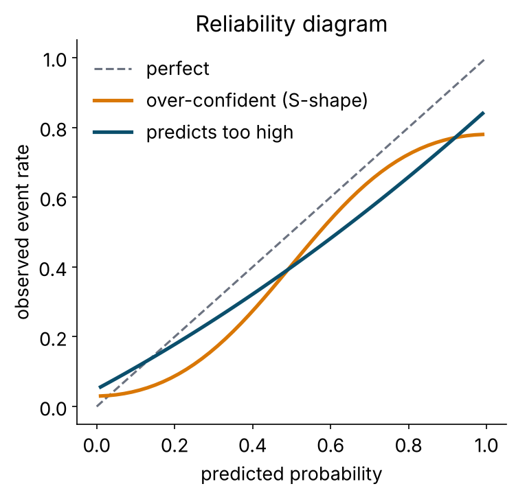
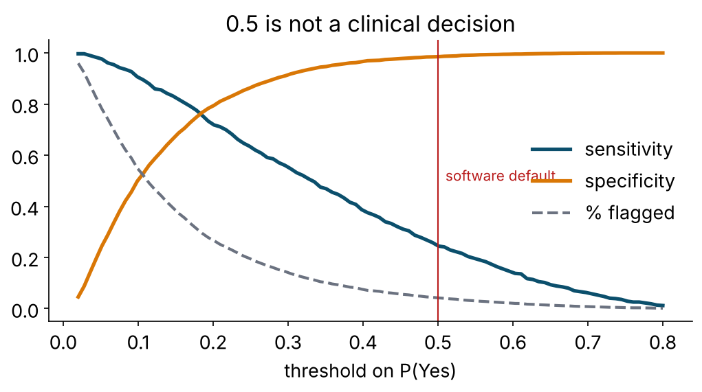
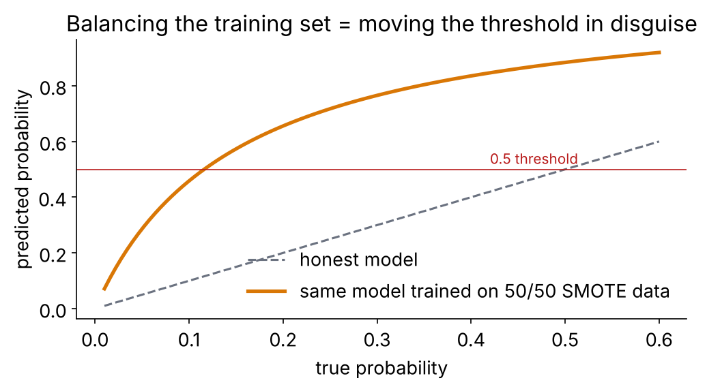
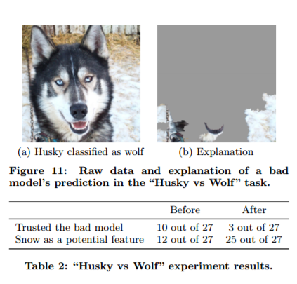
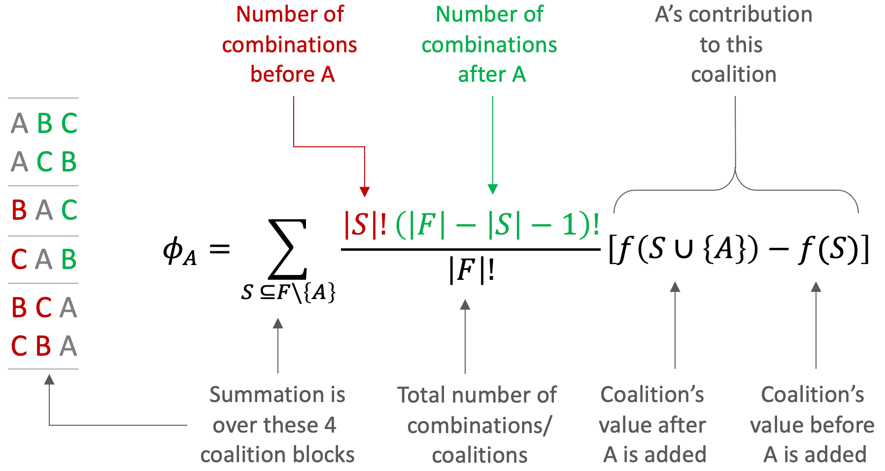

## A model is a probability. A decision is a threshold.

```{r}
augment(xgb_fit, dm_test) |> select(undx_dm, .pred_Yes, .pred_class)
#>   undx_dm .pred_Yes .pred_class
#>   No          0.07  No
#>   Yes         0.41  No          <- a "miss" at threshold 0.5; a "hit" at 0.3
```

- Every classifier we built outputs **P(Yes)**. `.pred_class` is just `P(Yes) ≥ 0.5`.
- 0.5 is a software default. It encodes the belief that a false positive and a false negative cost the same. In screening they never do.
- So: evaluate the **probabilities** (discrimination, calibration) *and* the **decision** (confusion matrix at the threshold you will actually use).

# Evaluating the decision {.section-slide .center background-color="#0b2545" background-gradient="linear-gradient(135deg, #0b2545 0%, #0f4c6e 55%, #13838f 100%)"}

## The confusion matrix, with its clinical names

| | **Truly Yes** | **Truly No** | |
|---|---|---|---|
| **Predicted Yes** | True positive (TP) | False positive (FP) | PPV = TP / (TP+FP) |
| **Predicted No** | False negative (FN) | True negative (TN) | NPV = TN / (TN+FN) |
| | Sensitivity = TP / (TP+FN) | Specificity = TN / (TN+FP) | |

| Metric | Other names | Asks |
|---|---|---|
| Sensitivity | recall, TPR | of the people who have it, how many did we flag? |
| Specificity | TNR | of the people who don't, how many did we leave alone? |
| PPV | precision | of the people we flagged, how many have it? |
| NPV | — | of the people we cleared, how many are truly clear? |
| Accuracy | — | overall fraction right (**useless** when classes are imbalanced) |
| F1 | — | harmonic mean of precision and recall (ignores TN; use with care) |
| Youden's J | — | sens + spec − 1 |
| Balanced accuracy | — | (sens + spec) / 2 |
| MCC, kappa | — | chance-corrected agreement |

```{r}
conf_mat(preds, undx_dm, .pred_class) |> summary()      # all of the above in one call
```

## Accuracy at 11.6 % prevalence

A model that says **"No" to everyone** has accuracy 0.884, sensitivity 0, and finds nobody.

Our honest logistic model at threshold 0.5: accuracy ≈ 0.89, sensitivity ≈ 0.2.
*It is barely better than the useless model on accuracy and vastly better on what matters.*

::: {.key}
Never lead with accuracy for an imbalanced outcome. Lead with sensitivity and specificity at the operating threshold, PPV/NPV at the prevalence you validated in, and AUC with a CI.
:::

## PPV is not a property of the model

{fig-align="center" height="400"}

$$\text{PPV} = \frac{\text{sens} \times \text{prev}}{\text{sens} \times \text{prev} + (1-\text{spec})(1-\text{prev})}$$

Validate in a clinic at 25 % prevalence, deploy at a pasar malam at 4 %, and the same model's PPV falls by two thirds. **Report the prevalence. Recompute PPV for the deployment population.**

# Evaluating the probabilities {.section-slide .center background-color="#0b2545" background-gradient="linear-gradient(135deg, #0b2545 0%, #0f4c6e 55%, #13838f 100%)"}

## ROC and AUC

{fig-align="center" height="380"}

- **ROC**: sensitivity vs 1−specificity at every threshold. **AUC** = P(a random case scores higher than a random non-case). 0.5 = coin; 1 = perfect.
- **Prevalence-blind** — good for comparing models across populations; **flattering** on rare outcomes, because false positives are a small fraction of a huge negative class.
- **Precision–recall**: PPV vs sensitivity. Baseline is the prevalence. Shows what the flagged people are *worth*. Use it alongside ROC when the outcome is rare.

## Gain and lift: for the programme manager

```{r}
gain_curve(test_preds, undx_dm, .pred_Yes) |> autoplot()
```

- x: fraction of the population you screen, ranked by model score; y: fraction of all cases you capture.
- "If we can only test 20 % of adults, the top-scoring 20 % contains 55 % of the undiagnosed cases" — that is a sentence a budget holder understands.
- Lift = gain ÷ fraction screened: 55 % / 20 % = 2.75× better than testing at random.

## Brier score

$$\text{Brier} = \frac{1}{n}\sum_i (p_i - y_i)^2 \qquad\text{(0 = perfect, lower is better)}$$

- The mean squared error of the **probabilities**. Rewards being right *and* being honest about uncertainty.
- Decomposes into **calibration** (are the probabilities right on average?) + **refinement/discrimination** (are they spread out usefully?).
- Reference points: predicting the prevalence for everyone gives prev × (1 − prev) ≈ 0.10 here. A model needs to beat that.
- `brier_class()` in yardstick; include it in every `metric_set()`.

## Calibration: do the probabilities mean what they say?

:::: {.columns}
::: {.column width="50%"}

:::
::: {.column width="50%"}
A **reliability diagram** bins people by predicted probability and plots the observed event rate per bin.

- On the diagonal: "40 %" means 40 %.
- Above: under-confident. Below: over-confident.
- A model can have **AUC 0.86 and still be badly calibrated** — random forests and boosted trees routinely are; SMOTE'd models always are.

```{r}
cal_plot_breaks(test_preds, truth = undx_dm, estimate = .pred_Yes)
cal_plot_windowed(test_preds, truth = undx_dm, estimate = .pred_Yes)
```
:::
::::

## Fixing calibration honestly

```{r}
cal_val <- cal_validate_logistic(xgb_cv, smooth = FALSE, metrics = metric_set(brier_class, roc_auc))
collect_metrics(cal_val)          # uncalibrated vs calibrated, estimated WITHIN resamples

calibrator     <- cal_estimate_logistic(cv_preds, truth = undx_dm, smooth = FALSE)   # fitted on CV predictions (Platt)
test_preds_cal <- cal_apply(test_preds, calibrator)                  # applied to the test set
```

- **Platt / logistic recalibration**: fit `truth ~ logit(p)`; two parameters; robust (`smooth = FALSE`; probably's default `smooth = TRUE` is a GAM). **Isotonic**: monotone step function; flexible, needs more data. **Beta calibration** in between.
- Fit the calibrator on **out-of-fold** predictions, never on the test set.
- Recalibration changes the probabilities, **not the ranking** → AUC unchanged, Brier improves, thresholds become meaningful.
- Clinical probabilities that will be *shown* to people (risk of 23 %) must be calibrated. Rankings that only sort a queue care less.

## Choosing the threshold on purpose

{fig-align="center" height="330"}

```{r}
thr <- threshold_perf(cv_preds, undx_dm, .pred_Yes, thresholds = seq(0.02, 0.6, 0.01))
```

| Approach | Rule | Comment |
|---|---|---|
| Target sensitivity | smallest threshold with sens ≥ 0.80 | screening programmes |
| Target specificity | threshold with spec ≥ 0.90 | expensive confirmatory tests |
| Capacity | threshold that flags exactly the x % you can test | the take-home challenge |
| Youden's J | maximise sens + spec − 1 | assumes equal costs; rarely true |
| Cost-weighted | minimise FN × cost_FN + FP × cost_FP | best when you can name the costs |

Decide on **CV predictions**. Report on the **test set**. Then write it in people: "test 35 %, find 80 %, 5 tests per case".

## Decision curve analysis (the clinician's metric)

```{r}
dcurves::dca(undx_dm ~ .pred_Yes, data = test_preds |> mutate(undx_dm = undx_dm == "Yes"),
             thresholds = seq(0.02, 0.5, 0.01)) |> plot(smooth = TRUE)
```

- **Net benefit** at threshold *t* = (TP − FP × t/(1−t)) / n. The threshold *is* the exchange rate between a false positive and a true positive.
- Compare the model to **test everyone** and **test no one** across plausible thresholds. A model is useful only where its curve sits above both.
- Vickers & Elkin (2006); now expected in clinical prediction papers alongside AUC and calibration.

## Class imbalance: the honest version

{fig-align="center" height="330"}

- Up-sampling, down-sampling, SMOTE (`themis`) make the training set 50/50. The model then thinks prevalence is 50 % → **every probability inflates** → sensitivity at 0.5 rises. That is a threshold change in disguise, with calibration destroyed as a side effect. AUC barely moves.
- **Preferred**: keep the real data, pick the threshold you need, recalibrate if required. Use class **weights** (`case_weights`, xgboost `scale_pos_weight`) if the algorithm needs help *ranking* the rare class.
- SMOTE belongs in the last resort drawer, with a calibration step after it.

# Explaining the model {.section-slide .center background-color="#0b2545" background-gradient="linear-gradient(135deg, #0b2545 0%, #0f4c6e 55%, #13838f 100%)"}

## Why explain?

:::: {.columns}
::: {.column width="55%"}
- **Trust**: is it predicting for the right reasons, or did it learn the hospital ID?
- **Debugging**: leakage shows up as one absurdly dominant variable.
- **Science**: hypothesis generation (that sex-specific waist threshold).
- **Regulation & ethics**: patients and clinicians are entitled to a reason; some jurisdictions require it.
- **Fairness**: does it work equally well by sex and ethnicity?
:::
::: {.column width="45%"}

:::
::::

::: {.credit}
Moneda (2021)
:::

## The taxonomy

| | **Global** (the whole model) | **Local** (one person) |
|---|---|---|
| **Model-specific** | coefficients (GLM), gain importance (xgboost), impurity importance (RF) | tree path (single tree) |
| **Model-agnostic** (works for anything, incl. the neural net) | permutation importance, partial dependence (PDP), ALE, SHAP summary | SHAP waterfall / force, break-down, LIME, ICE |

Tools today: the engines' own importances (`ranger::importance()`, `xgboost::xgb.importance()`), **`DALEX`/`DALEXtra`** (permutation importance, PDP, break-down), **`shapviz`** (TreeSHAP today; `kernelshap` for any model, tomorrow's network).

## Which variables matter: importance

```{r}
xgboost::xgb.importance(model = extract_fit_engine(xgb_fit))               # model-specific (gain, cover, frequency)

explainer <- explain_tidymodels(xgb_fit, data = dm_train |> select(-undx_dm),
                                y = dm_train$undx_dm == "Yes", predict_function_target_column = "Yes")
model_parts(explainer, loss_function = loss_one_minus_auc, B = 10) |> plot()   # permutation importance
```

- **Permutation importance**: shuffle one column, measure how much AUC falls. Model-agnostic and honest about *predictive* value.
- Caveats: **correlated predictors share credit** (BMI, waist, weight, bmi_cat all look weaker than "adiposity" is); impurity importance is biased toward continuous/high-cardinality predictors; importance says nothing about **direction**.

## How risk moves: partial dependence

```{r}
model_profile(explainer, variables = c("age", "bmi", "waist"), N = 500) |> plot()
model_profile(explainer, variables = "waist", groups = "sex", N = 500) |> plot()    # interaction check
```

- **PDP**: set `age = 50` for *everyone*, predict, average; repeat for every age. The curve is the model's average response to that variable.
- **ICE** curves: the same per person — shows heterogeneity hidden by the average. **ALE** plots fix the PDP's problem with correlated predictors (it asks the model about impossible people, e.g. BMI 15 with waist 120).
- Look for the structure the trees found: the BMI step near 27.5, the age plateau, two waist curves for two sexes.

## Why this person: SHAP

:::: {.columns}
::: {.column width="50%"}


**Shapley value** (game theory, 1953): a variable's fair share of the difference between *this* prediction and the average prediction, averaged over every order in which variables could be "added".

Properties: the contributions **add up exactly** to the prediction; consistent; model-agnostic.
:::
::: {.column width="50%"}
```{r}
X_baked <- bake(extract_recipe(xgb_fit), X_explain, all_predictors(), composition = "matrix")
sv <- shapviz(extract_fit_engine(xgb_fit), X_pred = X_baked, X = X_explain, collapse = dummies)

sv_importance(sv, kind = "beeswarm")                 # global: importance AND direction
sv_dependence(sv, v = "bmi", color_var = "fam_hx_dm")  # shape + interaction
sv_waterfall(sv, row_id = 1)                         # local: this person
```

- The model saw the **baked** matrix, so SHAP comes out per dummy column; `collapse` adds each factor back together.
- **TreeSHAP** (exact, instant) for tree ensembles; **KernelSHAP** (`kernelshap()`, approximate, any model) for the neural net this afternoon — same plots.
:::
::::

::: {.credit}
Linberry (2021)
:::

## What explanations do **not** mean

1. **Not causal.** SHAP/PDP describe the *fitted function*. "BMI drives risk up after 27.5" is a statement about the model. Whether BMI *causes* diabetes is a different study.
2. **Not unique.** Correlated predictors swap credit between fits; importance rankings shift across bootstrap resamples. Check stability before you tell a story.
3. **Not the whole truth.** A PDP averages away interactions; a beeswarm hides calibration; a waterfall for one person says nothing about the next.
4. **Not a safety certificate.** A model can be explainable and wrong, or unexplainable and right. Explanations are for *auditing*, not for *absolving*.

::: {.good}
Use explanations to ask: *does this agree with what we know?* Agreement → trust up. Disagreement → either you learned something or the model is cheating. Find out which.
:::

## Fairness: check it, don't assume it

```{r}
collect_predictions(xgb_last) |>
  bind_cols(dm_test |> select(sex, ethnic)) |>
  group_by(sex) |> roc_auc(undx_dm, .pred_Yes)
```

- Discrimination, calibration **and** sensitivity at the chosen threshold, by sex, ethnicity, age band, urban/rural.
- A model that under-flags women (or any group) at the shared threshold is a model that under-screens them. Fixes: group-specific thresholds, re-weighting, more data — and saying so in the paper.
- `fairmodels` extends DALEX with fairness metrics.

## Reporting: TRIPOD+AI (Collins et al., BMJ 2024)

The items people most often leave out:

- **Predictors**: when they were measured relative to the outcome; how missing data were handled *at model development and at deployment*
- **Sample size** rationale (events per candidate predictor; `pmsampsize`)
- **Model development**: resampling, tuning ranges and selection, software versions, seeds
- **Performance**: discrimination **with CI**, **calibration plot** (not just slope/intercept), **clinical utility** (decision curve), **by subgroup**
- **Fairness** and **open code/data** (or a reason why not)
- **Usability**: how a user gets a prediction; what the threshold is and why

**PROBAST+AI** is the risk-of-bias twin. Most published models fail its *analysis* domain — for the reasons covered this morning.

## → Tutorial 6 (`tutorials/06_evaluation.qmd`)

**Live coding:** confusion matrix and prevalence; ROC / PR / gain; Brier and calibration (+ recalibration); a threshold for a screening programme; SMOTE vs threshold; importance, PDP, SHAP.

**Your turn:** two use cases → two thresholds → one sentence for the district health officer; does it work equally well by sex and ethnicity?

Lunch at 13.00. Neural networks at 14.00.
