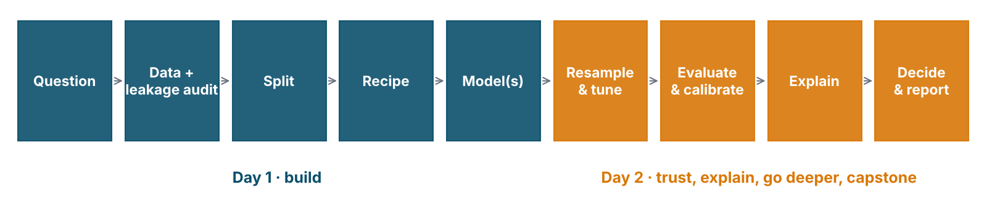

## The verdict: four families, one test set

*(live from `outputs/t07_verdict.rds` — Tutorial 7, section C6)*

| Model | roc_auc | pr_auc | brier | sens @0.5 | spec @0.5 |
|---|---|---|---|---|---|
| logistic baseline | | | | | |
| random forest | | | | | |
| SVM (RBF) | | | | | |
| XGBoost, tuned | | | | | |
| neural net, tuned | | | | | |

::: {.key}
A spread of a few hundredths of AUC across four model families. The data, the cleaning and the leakage audit moved
the needle by 0.1–0.5. Choose the model you can **explain, calibrate and deploy**.
:::

## The reveal: what the simulator actually planted

The data were simulated (`data-raw/simulate_nhms_synthetic.py`). For undiagnosed diabetes the truth contains:

- a steep **age** effect from 35 to 62, then a *decline* (survivorship)
- a BMI **threshold** at 27.5 (the Asian obesity cut-off), stronger than the linear BMI slope
- **family history × obesity** — the biggest single term
- **Indian ethnicity × overweight**; **central obesity × inactivity** with **sex-specific waist cut-offs** (M ≥ 90, F ≥ 80 cm)
- a **young-obese** bump (age < 35 and BMI ≥ 30); **male smokers** only; rural, poor and ≥ 50
- and `rbs` generated **from** the outcome — the leak.

Did the SHAP dependence plots find the family-history × BMI bands? The two waist curves? Did logistic regression —
which cannot see interactions unless told — keep up anyway? That gap between what the truth contains and what each
family can express is the whole reason to run a bake-off.

## Two days in ten rules

1. **Ask when** every predictor is known. If it is known *because of* the outcome, it is out.
2. **Event level first.** `levels(y)[1] == "Yes"`.
3. **Split with strata; lock the test set.** It answers one question, once.
4. **Pre-process inside the recipe**, so it is re-estimated inside every fold.
5. **Resample everything.** Report mean ± SE. One split is one draw.
6. **Tune on resamples**, with ranges you can defend; prefer the simplest model within one SE.
7. **Accuracy lies at low prevalence.** Sens/spec/PPV at the threshold you will use, at the prevalence you will face.
8. **Probabilities must be calibrated** before anyone acts on them. Brier + reliability plot, always.
9. **Choose the threshold from the use case**, on CV predictions. Write it in people.
10. **Explain to audit, not to absolve.** Importance → which; PDP → how; SHAP → why this person. None of it is causal.

## The pipeline you now own

{fig-align="center" width="100%"}

```{r}
split <- initial_split(data, strata = y);  folds <- vfold_cv(training(split), strata = y)
rec   <- recipe(y ~ ., training(split)) |> step_impute_median(all_numeric_predictors()) |>
           step_dummy(all_nominal_predictors()) |> step_zv(all_predictors()) |> step_normalize(all_numeric_predictors())
zoo   <- workflow_set(list(rec), list(glm = ..., rf = ..., svm = ..., xgb = ..., nn = ...)) |> workflow_map("fit_resamples", resamples = folds)
tuned <- tune_race_anova(workflow(rec, winner_with_tune()), folds, grid = 20)
final <- last_fit(finalize_workflow(..., select_best(tuned, metric = "roc_auc")), split)
cal_plot_breaks(collect_predictions(final), y, .pred_Yes);  threshold_perf(cv_preds, y, .pred_Yes)
shapviz(extract_fit_engine(final), X_pred = baked_X, X = X, collapse = dummies) |> sv_importance("beeswarm")   # or kernelshap() for any model
```

Swap the data, swap the outcome, and this is your next paper's methods section.

## The take-home challenge

**Who has undiagnosed hypertension?** A community screening tool with budget to measure **one adult in three**.
Full brief at the end of Tutorial 7.

1. Leakage audit (`sys`/`dys` define the outcome — what else goes?)
2. Split, folds, recipe
3. Bake-off: logistic, RF, SVM, XGBoost, `mlp()`
4. Race-tune the winner; one-SE rule
5. Threshold that flags one in three, on CV predictions; sens / PPV / number-needed-to-measure on the test set, once
6. Calibration plot; SHAP beeswarm; `age` coloured by `sex`
7. Two caveats

Expected honest AUC ≈ 0.81–0.83. If you see 0.95, go back to step 1. Send me your three best plots.

## From a model to something people use

| Step | Tools | One line |
|---|---|---|
| **Version & save** | `vetiver`, `pins` | a fitted workflow + metadata, stored and versioned |
| **Serve** | `vetiver` + `plumber` (API), `shiny` (app) | predictions from raw inputs, recipe baked in |
| **Monitor** | `vetiver_compute_metrics()`, drift checks | AUC and calibration **by month**; inputs vs training distribution |
| **Recalibrate / retrain** | `probably`, scheduled jobs | when calibration drifts; when the population changes |
| **Govern** | model card, TRIPOD+AI report, DECIDE-AI | who built it, on what, for whom, with what limits |

::: {.say}
A model that is not monitored is a model that is quietly getting worse.
:::

## Topics we deliberately left out

- **Regression** — same pipeline, `set_mode("regression")`, `rmse`/`rsq`/`mae`, `cal_plot_regression()`.
- **Survival / time-to-event** — `censored`: `proportional_hazards()`, `boost_tree()` in `"censored regression"` mode; dynamic AUC and Brier.
- **Multi-class** — same metrics with macro/micro averaging; softmax output.
- **Time-series forecasting** — `modeltime`, rolling-origin resampling.
- **Unsupervised** — `tidyclust`: k-means, hierarchical; phenotyping.
- **Causal ML** — targeted learning, causal forests (`grf`); *different question, different validation*.
- **Fairness** — `fairmodels`; subgroup calibration and thresholds.
- **LLMs in health** — a different workshop, the same discipline.

## Resources

- **Tidy Modeling with R** — tmwr.org (free; the reference for everything we did)
- **tidymodels.org** — Get Started, Learn, `?parsnip::details_*` for every engine
- **Julia Silge's blog & screencasts** — juliasilge.com
- **ISLR2 with tidymodels labs** — statlearning.com · emilhvitfeldt.github.io/ISLR-tidymodels-labs
- **Interpretable Machine Learning** — Molnar (free online)
- **StatQuest** — the pictures in decks 03–05 came from there; the watch-list is in `instructor/statquest_watchlist.md`
- **TRIPOD+AI** (Collins et al., *BMJ* 2024) · **PROBAST+AI** · **DECIDE-AI**
- **Clinical Prediction Models** — Steyerberg (2e)
- These materials: github.com/vivekjason — tutorials, slides, data generator

## Thank you

Please fill in the feedback form before you leave — it decides what Series 6 looks like.

The tutorials stay online. Email with questions; better still, send a pull request.

*Vivek Jason Jayaraj · Centre for Population Health · Universiti Malaya*
