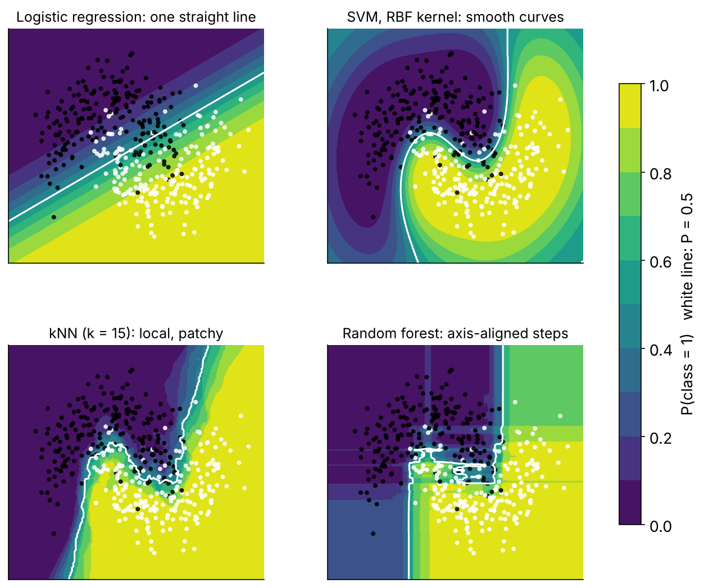

::: {.callout-note icon=false}
## What you will do

See what shape of boundary an SVM draws and why; fit a linear, a polynomial and a radial-kernel SVM on the
honest predictor set through the same workflow; learn which pre-processing an SVM cannot live without; and compare
kernels honestly on the five folds.

**Time:** 25 min live coding + 15 min *Your turn*.
:::

## 0 · Start

```{r}
#| label: setup
# WHERE WE ARE ---------------------------------------------------------------------------------------------
# T1 = the pipeline + logistic baseline (replayed by R/prep_nhms.R). T2 = trees and the random forest, fitted
# with fit_resamples() on the same dm_folds and the same cls_metrics. NEW TODAY: the second family - support
# vector machines - and the first model for which the recipe's normalisation step is not optional.
source("R/prep_nhms.R")
library(patchwork)
library(future)
plan(multisession, workers = max(1, parallel::detectCores() - 1))
```

## 1 · The idea, in four pictures

::: {.callout-note}
## In one paragraph
Start with one predictor and two classes. A **threshold** classifies, but a point just over it is called positive
even when it looks like the negatives. The **maximal-margin classifier** puts the boundary halfway between the
closest members of the two classes — as far from both as possible. One outlier drags that boundary into a terrible
place, so we allow some points inside the margin or on the wrong side: a **soft margin**, whose generosity is set
by cross-validation. That is a **support vector classifier**; the *support vectors* are the few points that touch
or cross the margin — the only ones that matter. In two dimensions the boundary is a line, in three a plane, in
*p* a hyperplane — still straight. When the classes overlap so that no straight boundary works, a **kernel** maps
the data into a higher dimension where they *are* separable by a hyperplane, and the boundary projected back is
curved. The kernel trick means you never compute the high-dimensional coordinates, only similarities between
pairs of points.
:::

{fig-align="center" width="85%"}

Two kernels you will use:

| Kernel | parsnip | Shape | Flexibility knob |
|---|---|---|---|
| Linear | `svm_linear(cost)` | hyperplane | — |
| Polynomial | `svm_poly(cost, degree, scale_factor)` | polynomial curve | `degree`: 1 = linear, 2–3 = gentle curves, higher = wiggly |
| Radial basis (RBF) | `svm_rbf(cost, rbf_sigma)` | Gaussian bumps around support vectors; can enclose islands | `rbf_sigma`: large = narrow bumps = wiggly; small = wide bumps = smooth |

And the knob every kernel shares: **`cost`** — the penalty for a point violating the margin. High cost → narrow
margin, fits the training data closely, overfits. Low cost → wide margin, underfits. Tune it on a log₂ scale.

## 2 · What an SVM needs from the recipe

Two non-negotiables:

1. **Numeric predictors** — SVMs compute distances; "Indian" has no distance from "Malay". `step_dummy()`.
2. **Scaled predictors** — otherwise `hh_income` (thousands) defines the distance and `age` (tens) is ignored.
   `step_normalize()`.

`dm_rec` already does both, which is why it was written that way in Tutorial 1. One engine-specific wrinkle:
`kernlab::ksvm()` quietly standardises numeric inputs itself (`scaled = TRUE` is its default), so with this engine
an unscaled recipe is *rescued* behind your back. Other SVM implementations (`LiblineaR`, `e1071` with
`scale = FALSE`, anything you write in Python) do not, and neither do the neural networks this afternoon — keep the
scaling in the recipe, where it is visible, versioned and applied identically at prediction time.

```{r}
#| label: rec
dm_rec
```

## 3 · Three kernels, one workflow

```{r}
#| label: specs
svm_lin_spec  <- svm_linear(cost = 1) |> set_engine("kernlab") |> set_mode("classification")
svm_poly_spec <- svm_poly(cost = 1, degree = 2) |> set_engine("kernlab") |> set_mode("classification")
svm_rbf_spec  <- svm_rbf(cost = 1, rbf_sigma = 0.005) |> set_engine("kernlab") |> set_mode("classification")
```

`rbf_sigma = 0.005` is a reasonable start for ~45 scaled predictors (kernlab's own heuristic, `sigest()`, lands
nearby). Leave it out and kernlab estimates it for you.

Fit the RBF version once and look at what came back:

```{r}
#| label: fit-rbf
svm_rbf_fit <- workflow(dm_rec, svm_rbf_spec) |> fit(dm_train)
svm_rbf_fit |> extract_fit_engine()
```

Note the **number of support vectors** — the people that define the boundary — and that kernlab fitted a
logistic model on top ("probability model") so that we can get `.pred_Yes`. SVMs do not produce probabilities
natively; this *Platt scaling* is a bolt-on, and its calibration is so-so (Tutorial 6 will show you how to check).

```{r}
#| label: predict-rbf
augment(svm_rbf_fit, dm_train) |> cls_metrics(truth = undx_dm, estimate = .pred_class, .pred_Yes)
```

That is the **training** performance — reported only to make a point in *Your turn*. The honest number is below.

## 4 · Honest comparison on the five folds

```{r}
#| label: cv
set.seed(2026)
svm_res <- workflow_set(
  preproc = list(base = dm_rec),
  models  = list(linear = svm_lin_spec, poly2 = svm_poly_spec, rbf = svm_rbf_spec)
) |>
  workflow_map("fit_resamples", resamples = dm_folds, metrics = cls_metrics, seed = 2026, verbose = TRUE)

rank_results(svm_res, rank_metric = "roc_auc", select_best = TRUE) |>
  filter(.metric %in% c("roc_auc", "brier_class")) |>
  select(wflow_id, .metric, mean, std_err)
autoplot(svm_res, metric = c("roc_auc", "brier_class"))
```

Three things to notice while it runs:

- **It is slower than the forest.** SVM training cost grows roughly with *n²* (every pair of points enters the
  kernel matrix). 4,000 rows is fine; 400,000 is not. The probability model roughly doubles the time again.
- The kernels are usually **within one standard error** of each other here — and of this morning's logistic
  regression. The simulated truth is close to additive with a few interactions, and a linear SVM on 45 scaled
  dummies is, in effect, a regularised logistic regression.
- Nothing in the output tells you *why* a person was classified. No coefficients you can read (except for the
  linear kernel), no trees, no importances without the model-agnostic tools of Tutorial 6.

## 5 · Where SVMs fit today

SVMs were the best general-purpose classifier from roughly 1995 to 2010. Gradient boosting took that title for
tabular data (tomorrow morning) and deep learning took it for images and text. They remain excellent for **small,
high-dimensional, clean** problems — gene-expression panels, text classification, some signal problems — and the
margin idea underpins a lot of later theory. For survey-type health data you will rarely choose one over XGBoost,
but you should be able to fit, tune and explain one when a reviewer asks.

```{r}
#| label: save
dir.create("outputs", showWarnings = FALSE)
saveRDS(svm_res, "outputs/t03_svm_res.rds")    # kept for reference; nothing later depends on it
```

## Your turn (15 min)

::: {.callout-tip icon=false}
## Task A · Cost and overfitting
Fit `svm_rbf(cost = ___, rbf_sigma = 0.005)` for `cost` in {0.1, 1, 10, 100} with `fit_resamples()` on
`dm_folds` (use a `workflow_set()` so it is one call). For each, also record the **training-set** AUC from a plain
`fit()` on `dm_train`. Plot or tabulate training AUC and CV AUC against cost.

**A1.** Which direction does the gap between training and CV AUC move as cost rises? Why?
**A2.** Which cost would you pick, and would you want to try values outside this range?
:::

::: {.callout-note collapse="true"}
## Solution A

```{r}
#| label: solA
costs <- c(0.1, 1, 10, 100)
svm_costs <- lapply(costs, \(cst) svm_rbf(cost = cst, rbf_sigma = 0.005) |> set_engine("kernlab") |> set_mode("classification"))
names(svm_costs) <- paste0("cost_", costs)

set.seed(2026)
cost_cv <- workflow_set(preproc = list(base = dm_rec), models = svm_costs) |>
  workflow_map("fit_resamples", resamples = dm_folds, metrics = metric_set(roc_auc), seed = 2026)

cv_auc <- collect_metrics(cost_cv) |>
  transmute(cost = readr::parse_number(wflow_id), cv_auc = mean, se = std_err)

train_auc <- tibble(
  cost = costs,
  train_auc = sapply(svm_costs, \(spec) workflow(dm_rec, spec) |> fit(dm_train) |>
                       augment(dm_train) |> roc_auc(undx_dm, .pred_Yes) |> pull(.estimate))
)

left_join(cv_auc, train_auc, by = "cost")
```

A1: training AUC climbs toward 1 as cost rises (the margin narrows and the boundary bends around individual
points) while CV AUC flattens or falls — the classic overfitting gap. A2: the CV optimum is usually at cost ≈ 1 or
below; it is worth probing 0.01–0.3 as well. This is exactly what `tune_grid()` automates tomorrow, on a log
scale.
:::

::: {.callout-tip icon=false}
## Task B · What happens without scaling? (5 min)
Build `rec_noscale` = `dm_rec` without `step_normalize()` (impute, dummy, zv only). Because kernlab would
silently rescale for you, switch that off with `set_engine("kernlab", scaled = FALSE)` so you see what the kernel
actually does with raw units. Resample and compare the CV AUC with the scaled version.
:::

::: {.callout-note collapse="true"}
## Solution B

```{r}
#| label: solB
rec_noscale <- recipe(undx_dm ~ ., data = dm_train) |>
  step_impute_median(all_numeric_predictors()) |>
  step_impute_mode(all_nominal_predictors()) |>
  step_dummy(all_nominal_predictors()) |>
  step_zv(all_predictors())

svm_raw_spec <- svm_rbf(cost = 1, rbf_sigma = 0.005) |>
  set_engine("kernlab", scaled = FALSE) |>      # stop kernlab from standardising internally
  set_mode("classification")

set.seed(2026)
noscale_res <- fit_resamples(workflow(rec_noscale, svm_raw_spec), dm_folds, metrics = metric_set(roc_auc, brier_class))
collect_metrics(noscale_res)
```

Noticeably worse: with `hh_income` in ringgit dominating every distance, the kernel "sees" income and little
else. Scaling is not a nicety for distance-based methods (SVMs, neural networks); it is part of the model. (Had you
left kernlab's default `scaled = TRUE`, the two recipes would have tied — and you would have learned the wrong
lesson. Know what your engine does for you.)
:::

## What to remember

1. SVM = widest possible street between the classes, with a `cost`-controlled tolerance for violations.
2. Kernels bend the street; `rbf_sigma`/`degree` set how much. Both knobs need tuning on a log scale.
3. Numeric + scaled inputs are mandatory. Probabilities are a bolt-on; check their calibration.
4. Slow for large *n*; opaque without model-agnostic explanation tools.

**Next (Day 2, 09.15):** Tutorial 4 — gradient boosting with XGBoost, and the bake-off of all four.
