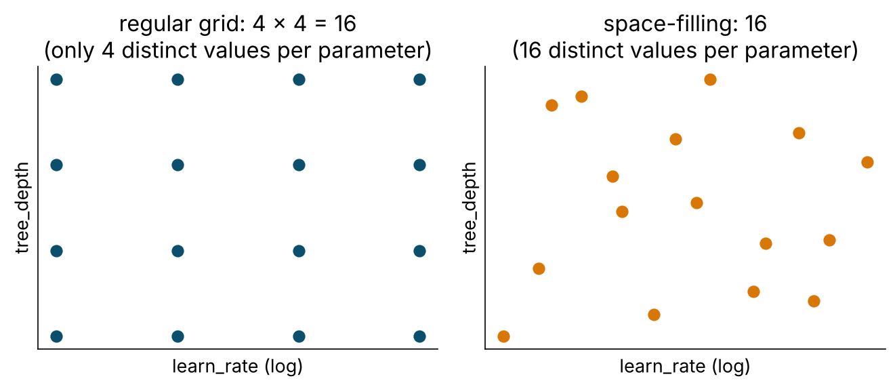

::: {.callout-note icon=false}
## What you will do

See with your own eyes that a single train/test split is a noisy measurement; meet the resampling menu; mark
XGBoost's hyperparameters with `tune()`, define a search space, search it with a grid and then with **racing**;
pick a winner with the one-standard-error rule; and finally **touch the test set once** with `last_fit()`.

**Time:** 25 min live coding + 10 min *Your turn*.
:::

## 0 · Start

```{r}
#| label: setup
# WHERE WE ARE ---------------------------------------------------------------------------------------------
# Three families and a baseline, compared on the same folds (T4 bake-off). Every one of them used hand-picked
# hyperparameters. NEW TODAY: tune() replaces the hand-picked values - grids, racing, the one-SE rule - and the
# tuned XGBoost is saved to outputs/t05_xgb_last.rds, which Tutorials 6 and 7 load instead of refitting.
source("R/prep_nhms.R")
library(finetune)
library(future)
plan(multisession, workers = max(1, parallel::detectCores() - 1))
dir.create("outputs", showWarnings = FALSE)

lr_wf <- workflow(dm_rec, logistic_reg() |> set_engine("glm"))
```

## 1 · Why one split lies

The same logistic model, 25 different random 80/20 splits:

```{r}
#| label: many-splits
set.seed(1)
many_splits <- mc_cv(dm_data, prop = 0.80, times = 25, strata = undx_dm)   # Monte-Carlo CV = repeated random splits

set.seed(1)
lr_many <- fit_resamples(lr_wf, many_splits, metrics = metric_set(roc_auc))

collect_metrics(lr_many, summarize = FALSE) |>
  ggplot(aes(.estimate)) +
  geom_histogram(bins = 12, fill = "#0b4f6c") +
  labs(x = "test-set AUC", y = NULL, title = "Same model, 25 random splits",
       subtitle = "Whoever reported the maximum would be lying by accident") +
  theme_minimal()

collect_metrics(lr_many)     # mean and std_err: THIS is what to report
```

Nothing changed but *which* 1,000 people were held out. Any number in that spread is a legitimate "test-set AUC".
A paper that reports the top of it is not lying; it is reporting one draw from a distribution and calling it the
answer. With ~115 cases in a test set the spread is unavoidable.

::: {.callout-important}
Report **mean ± standard error across resamples**. The SE is the number that tells you whether two models differ.
:::

## 2 · The resampling menu

```{r}
#| label: menu
dm_folds                                                     # 5-fold, stratified: what we have used all along
vfold_cv(dm_train, v = 10, repeats = 3, strata = undx_dm)    # 30 fits: less variance, 6x the cost
bootstraps(dm_train, times = 25, strata = undx_dm)           # sample WITH replacement; out-of-bag rows = assessment
```

| Scheme | `rsample` | Use when |
|---|---|---|
| k-fold CV | `vfold_cv(v = 10)` | the default for comparing and tuning |
| repeated k-fold | `vfold_cv(v = 10, repeats = 5)` | you can afford it; lowers the variance of the estimate |
| stratified | `strata = outcome` | **always**, for outcomes under ~30 % |
| Monte-Carlo | `mc_cv()` | quick look at split-to-split variance |
| bootstrap | `bootstraps()` | small n; confidence intervals (`int_pctl()`) |
| grouped | `group_vfold_cv(group = id)` | repeated measures, multi-site |
| rolling origin | `sliding_period()` | forecasting |
| nested | outer folds + inner tuning | unbiased estimate of a *tuned* pipeline (see §6) |

Look inside one fold:

```{r}
#| label: inside-fold
dm_folds$splits[[1]]
analysis(dm_folds$splits[[1]])   |> nrow()    # the 4/5 used for fitting: recipe prepped HERE, model fitted HERE
assessment(dm_folds$splits[[1]]) |> nrow()    # the 1/5 held out: baked with the analysis set's medians and SDs
```

Imputation medians, scaling, dummy levels, SMOTE, feature selection — everything estimated from data is
re-estimated on the analysis set, five separate times. That is why pre-processing lives in a recipe inside a
workflow and not in a `mutate()` before the split.

## 3 · Tuning: mark, bound, search

### Mark what to tune

```{r}
#| label: tune-spec
xgb_tune_spec <- boost_tree(trees = 500, learn_rate = tune(), tree_depth = tune(), min_n = tune(), sample_size = tune()) |>
  set_engine("xgboost") |>
  set_mode("classification")

xgb_tune_wf <- workflow(dm_rec, xgb_tune_spec)
```

`tune()` is a placeholder. The workflow is complete but cannot be `fit()` until the placeholders are filled.

### Bound the search space (`dials`)

```{r}
#| label: params
xgb_params <- extract_parameter_set_dials(xgb_tune_wf) |>
  update(
    learn_rate  = learn_rate(range = c(-2.5, -0.5)),    # log10 scale -> 0.003 .. 0.32
    tree_depth  = tree_depth(range = c(2L, 8L)),
    min_n       = min_n(range = c(5L, 60L)),
    sample_size = sample_prop(range = c(0.5, 1))
  )
xgb_params
```

Every tunable argument has a `dials` object with a default range and, where sensible, a **log transform**
(`learn_rate`, `penalty`, `cost`, `rbf_sigma`). Tune those on the log scale or you waste most of the grid at one
end. Defaults are deliberately wide — narrow them with domain sense. Ranges that depend on the data (`mtry` ≤ number
of predictors) need `finalize()` or an explicit `update()`.

### Lay out the candidates

```{r}
#| label: grids
grid_regular(xgb_params, levels = 3) |> nrow()          # 3^4 = 81 candidates, only 3 distinct values each
set.seed(2026)
xgb_grid <- grid_space_filling(xgb_params, size = 20)   # 20 candidates spread evenly over the 4-D space
xgb_grid
```

{fig-align="center" width="70%"}

### Search: every candidate × every fold

```{r}
#| label: tune-grid
set.seed(2026)
t0 <- Sys.time()
xgb_tuned <- tune_grid(xgb_tune_wf, resamples = dm_folds, grid = xgb_grid,
                       metrics = metric_set(roc_auc, brier_class), control = control_grid(save_pred = TRUE))
Sys.time() - t0

collect_metrics(xgb_tuned) |> filter(.metric == "roc_auc") |> arrange(desc(mean)) |> head()
autoplot(xgb_tuned, metric = "roc_auc") + theme_minimal()
```

Read the panels: a **flat** panel means that parameter does not matter much in this range; a **slope or peak**
tells you where to look next. Learning rate is almost always the one that matters.

### Choose

```{r}
#| label: select
show_best(xgb_tuned, metric = "roc_auc", n = 5)

select_best(xgb_tuned, metric = "roc_auc")                                      # numerically best
select_by_one_std_err(xgb_tuned, metric = "roc_auc", tree_depth, desc(min_n))   # SIMPLEST within 1 SE of best
```

::: {.callout-tip}
## The one-standard-error rule
Among candidates whose score is within one standard error of the best, choose the **simplest** (shallower trees,
larger leaves, more regularisation). Simpler = less overfit, faster, easier to explain — and the "best" was
probably best by luck. The sorting arguments define what "simpler" means.
:::

## 4 · Racing: stop wasting folds on hopeless candidates

```{r}
#| label: race
set.seed(2026)
t0 <- Sys.time()
xgb_race <- tune_race_anova(xgb_tune_wf, resamples = dm_folds, param_info = xgb_params, grid = 30,
                            metrics = metric_set(roc_auc, brier_class),
                            control = control_race(verbose_elim = TRUE, save_pred = TRUE))
Sys.time() - t0
plot_race(xgb_race) + theme_minimal()
show_best(xgb_race, metric = "roc_auc", n = 5)
```

After the first three folds an ANOVA model asks, for each candidate, "is this one significantly worse than the
leader?" — and if so, drops it. Thirty candidates in about the time twenty took, same answer.

::: {.callout-note collapse="true"}
## Also available: Bayesian optimisation
```{r}
#| label: bayes
#| eval: false
set.seed(2026)
xgb_bayes <- tune_bayes(xgb_tune_wf, resamples = dm_folds, initial = xgb_tuned, iter = 10, param_info = xgb_params,   # seed it with the grid results
                        metrics = metric_set(roc_auc, brier_class), control = control_bayes(no_improve = 5, verbose_iter = TRUE))
autoplot(xgb_bayes, type = "performance")
```
It fits a model of *metric ~ hyperparameters* to the results so far and proposes the next most promising
candidate. Worth it when each fit is expensive and you can afford few evaluations.
:::

## 5 · Finalise — and the test set, once

```{r}
#| label: finalize
xgb_final_wf <- finalize_workflow(xgb_tune_wf, select_best(xgb_race, metric = "roc_auc"))
xgb_final_wf

xgb_last <- last_fit(xgb_final_wf, split = dm_split, metrics = cls_metrics)
collect_metrics(xgb_last)
```

`last_fit()` fits the finalised workflow on **all** training data and predicts the locked test set, in one call.
This is the first time `dm_test` has been touched since Tutorial 1. If the test estimate and the CV estimate
disagree wildly, something is wrong — a leak in CV, distribution shift, or bad luck with 115 cases. Investigate;
do **not** go back and re-tune on the test set.

```{r}
#| label: compare-lr
set.seed(2026)
lr_last <- last_fit(lr_wf, split = dm_split, metrics = cls_metrics)
bind_rows(logistic = collect_metrics(lr_last), xgb_tuned = collect_metrics(xgb_last), .id = "model") |>
  select(model, .metric, .estimate) |>
  pivot_wider(names_from = model, values_from = .estimate)

xgb_fit <- extract_workflow(xgb_last)     # the fitted workflow: save it, deploy it, explain it tomorrow
saveRDS(xgb_last, "outputs/t05_xgb_last.rds")
saveRDS(xgb_race, "outputs/t05_xgb_race.rds")
```

Tuning took XGBoost from "worse than logistic" (yesterday's defaults) to "a little better". That is the honest
size of the prize on tabular health data. Cleaning and the leakage audit moved the needle by 0.1–0.5.

## 6 · Two things to know, not to do today

**Nested cross-validation.** Picking the best of 30 noisy candidates and reporting its CV score is slightly
optimistic. Usually small (≤ 0.01 AUC) and the locked test set catches it. With small *n*, many candidates, or no
test set, run an outer loop of folds and do the whole tuning inside each — `nested_cv()` plus a little `purrr`;
TMwR has a worked chapter.

**Parallel processing changed.** `tune` ≥ 1.3 uses the `future` framework. `doParallel::registerDoParallel()`
from older notes does nothing now. `plan(multisession, workers = n)` is all you need; stop at 3–4 workers on an
8 GB laptop.

## Your turn (10 min)

::: {.callout-tip icon=false}
## Task A · Tune the random forest (or the SVM) with racing
Random forests have two knobs that matter. Race them.

```{r}
#| label: taskA
#| eval: false
n_pred <- dm_rec |> prep() |> bake(new_data = NULL) |> select(-undx_dm) |> ncol()   # upper limit for mtry

rf_tune_wf <- workflow(dm_rec, rand_forest(trees = 500, mtry = tune(), min_n = tune()) |>
                         set_engine("ranger") |> set_mode("classification"))
rf_params <- extract_parameter_set_dials(rf_tune_wf) |>
  update(mtry = mtry(range = c(2L, ___)), min_n = min_n(range = c(___, ___)))

set.seed(2026)
rf_race <- tune_race_anova(rf_tune_wf, dm_folds, param_info = rf_params, grid = 15,
                           metrics = metric_set(roc_auc, brier_class), control = control_race(verbose_elim = TRUE))
plot_race(rf_race)
show_best(rf_race, metric = "roc_auc", n = 5)
```

**A1.** How many candidates survived to the last fold, compared with XGBoost? What does that tell you about the
forest? **A2.** From `show_best(n = 10)`, apply the one-SE rule by eye: the simplest candidate (larger `min_n`,
smaller `mtry`) within one SE of the best.
:::

::: {.callout-note collapse="true"}
## Solution A

```{r}
#| label: solA
n_pred <- dm_rec |> prep() |> bake(new_data = NULL) |> select(-undx_dm) |> ncol()

rf_tune_wf <- workflow(dm_rec, rand_forest(trees = 500, mtry = tune(), min_n = tune()) |>
                         set_engine("ranger") |> set_mode("classification"))
rf_params <- extract_parameter_set_dials(rf_tune_wf) |>
  update(mtry = mtry(range = c(2L, 18L)), min_n = min_n(range = c(5L, 60L)))

set.seed(2026)
rf_race <- tune_race_anova(rf_tune_wf, dm_folds, param_info = rf_params, grid = 15,
                           metrics = metric_set(roc_auc, brier_class), control = control_race(verbose_elim = TRUE))
plot_race(rf_race) + theme_minimal()

top <- show_best(rf_race, metric = "roc_auc", n = 10) |> mutate(within_1se = mean >= max(mean) - std_err[1])
top
top |> filter(within_1se) |> arrange(desc(min_n), mtry) |> slice(1)
```

Most forest candidates survive all five folds and the AUC range across the grid is ~0.01: random forests are
insensitive to their settings. (`select_by_one_std_err()` exists, but on a racing object it also averages the
early-eliminated candidates, so apply the rule by hand as above.) The one-SE pick usually has a large `min_n` —
smoother probabilities, better Brier, same AUC.
:::

## What to remember

1. One split = one noisy draw. Resample; report mean ± SE.
2. `tune()` marks; `dials` bounds (log scales!); `tune_grid()` / `tune_race_anova()` search — always on resamples.
3. Prefer the simplest candidate within one SE of the best.
4. `finalize_workflow()` → `last_fit()` → the test set, exactly once.

**Next:** Tutorial 6 — evaluation, calibration and explanation (Session 7, 11.50).
