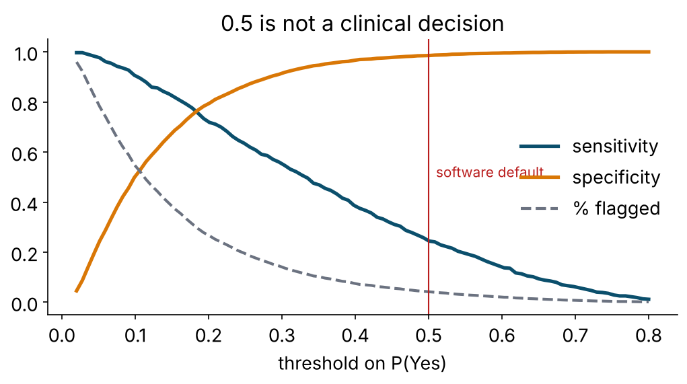
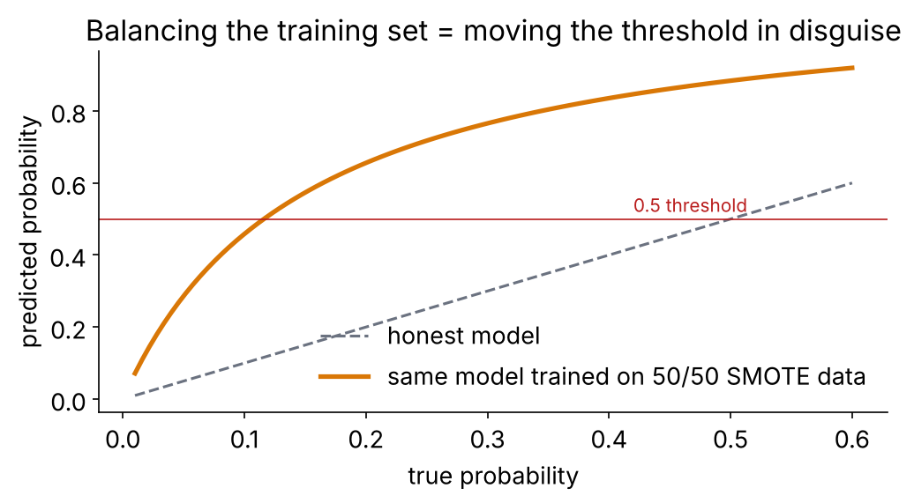

::: {.callout-note icon=false}
## What you will do

Evaluate the tuned XGBoost the way a clinician needs it evaluated: the confusion matrix at *this* prevalence,
ROC against precision–recall, Brier score and **calibration**, a decision threshold chosen for a screening
programme, the honest version of "class imbalance"; then explain the model globally (importance, partial
dependence) and locally (SHAP) — with code that works unchanged for the neural network this afternoon.

**Time:** 30 min live coding + 10 min *Your turn*.
:::

## 0 · Start

```{r}
#| label: setup
# WHERE WE ARE ---------------------------------------------------------------------------------------------
# Pipeline (T1), three families (T2-T4), tuning (T5). From here on the model is fixed: the tuned XGBoost from T5
# (loaded below from outputs/, with a fallback so this page also stands alone). NEW TODAY: judging it the way a
# clinician needs - confusion matrix at the real prevalence, ROC vs PR, calibration, choosing a threshold on
# purpose, class imbalance - and explaining it (importance, partial dependence, SHAP).
source("R/prep_nhms.R")
library(probably)      # calibration, thresholds
library(themis)        # class-imbalance recipe steps
library(DALEXtra)      # model-agnostic explanations for tidymodels
library(shapviz)       # SHAP plots
library(patchwork)
library(future)
plan(multisession, workers = max(1, parallel::detectCores() - 1))
dir.create("outputs", showWarnings = FALSE)

# the tuned XGBoost from Tutorial 5 (falls back to a fixed sensible version so this page stands alone)
if (file.exists("outputs/t05_xgb_last.rds")) {
  xgb_last <- readRDS("outputs/t05_xgb_last.rds")
} else {
  xgb_spec <- boost_tree(trees = 500, learn_rate = 0.03, tree_depth = 3, min_n = 20, sample_size = 0.8) |>
    set_engine("xgboost") |> set_mode("classification")
  set.seed(2026)
  xgb_last <- last_fit(workflow(dm_rec, xgb_spec), dm_split, metrics = cls_metrics)
}
xgb_fit      <- extract_workflow(xgb_last)                       # fitted workflow (recipe + model)
xgb_final_wf <- workflow(dm_rec, extract_spec_parsnip(xgb_fit))  # same spec, unfitted, for resampling
test_preds   <- collect_predictions(xgb_last)                    # predictions on the locked test set

# out-of-fold predictions on the TRAINING set: every DECISION (threshold, calibration) is made on these,
# so the test set stays an honest final exam
set.seed(2026)
xgb_cv   <- fit_resamples(xgb_final_wf, dm_folds, metrics = cls_metrics, control = control_resamples(save_pred = TRUE))
cv_preds <- collect_predictions(xgb_cv)
```

## 1 · A model is a probability; a decision is a threshold

```{r}
#| label: probs
test_preds |> select(undx_dm, .pred_Yes, .pred_class) |> head()
```

Every classifier we built outputs **P(Yes)**; `.pred_class` is just `P(Yes) ≥ 0.5`. The 0.5 is a software default
that silently assumes a false positive and a false negative cost the same. In screening they never do. So we
evaluate the probabilities (discrimination, calibration) *and* the decision (confusion matrix at the threshold
we will actually use) — separately.

## 2 · The confusion matrix at the default threshold — and why it misleads

```{r}
#| label: confmat
test_preds |> conf_mat(undx_dm, .pred_class) |> autoplot(type = "heatmap")
test_preds |> conf_mat(undx_dm, .pred_class) |> summary() |>
  filter(.metric %in% c("accuracy", "sens", "spec", "ppv", "npv", "j_index"))
```

Accuracy near 0.89 looks fine and is worthless: 88 % of people are *No*. Sensitivity at 0.5 is poor. Nobody told
the model that missing a diabetic costs more than an extra blood test.

| Metric | Also called | Asks |
|---|---|---|
| sensitivity | recall, TPR | of the people who have it, how many did we flag? |
| specificity | TNR | of the people who don't, how many did we leave alone? |
| PPV | precision | of the people we flagged, how many have it? |
| NPV | — | of the people we cleared, how many are truly clear? |
| J (Youden) | — | sens + spec − 1 |

### PPV is not a property of the model

```{r}
#| label: ppv
ppv_at <- function(sens, spec, prev) (sens * prev) / (sens * prev + (1 - spec) * (1 - prev))
tibble(prevalence = c(0.02, 0.05, 0.116, 0.25)) |> mutate(ppv = ppv_at(sens = 0.80, spec = 0.75, prev = prevalence))
```

Same sensitivity and specificity, four populations, four PPVs. A model validated in a clinic (25 %) and deployed
at a pasar malam (4 %) will see its PPV collapse. **Report the prevalence you validated at** — TRIPOD+AI asks for
exactly this.

## 3 · Threshold-free: ROC, precision–recall, gain

```{r}
#| label: curves
#| fig-width: 12
#| fig-height: 4
roc_auc(test_preds, undx_dm, .pred_Yes); pr_auc(test_preds, undx_dm, .pred_Yes)

p_roc  <- roc_curve(test_preds, undx_dm, .pred_Yes)  |> autoplot() + labs(title = "ROC")
p_pr   <- pr_curve(test_preds, undx_dm, .pred_Yes)   |> autoplot() + labs(title = "Precision-recall (baseline = 0.116)")
p_gain <- gain_curve(test_preds, undx_dm, .pred_Yes) |> autoplot() + labs(title = "Gain: screen the top x%, find y% of cases")
p_roc + p_pr + p_gain
```

- **ROC** is prevalence-blind — good for comparing models across populations, flattering on rare outcomes.
- **Precision–recall** shows what the positive predictions are *worth*; its baseline is the prevalence.
- **Gain** is the one for a programme manager: "if we can only test 20 % of adults, which 20 %, and what share of
  cases do we catch?"

## 4 · Calibration: do the probabilities mean what they say?

```{r}
#| label: calibration
brier_class(test_preds, undx_dm, .pred_Yes)    # 0 = perfect; predicting the prevalence for everyone gives ~0.10
cal_plot_breaks(test_preds, truth = undx_dm, estimate = .pred_Yes, num_breaks = 10) + labs(title = "Reliability diagram, test set")
cal_plot_windowed(test_preds, truth = undx_dm, estimate = .pred_Yes) + labs(title = "Windowed calibration, test set")
```

A point at (0.40, 0.25) means: when the model says 40 %, only 25 % actually have it. A model can have AUC 0.86 and
still be badly calibrated — boosted trees and forests routinely are, and SMOTE'd models always are. A probability
a clinician will *show* to a patient must be calibrated; a score that only sorts a queue cares less.

### Fix it honestly: estimate on CV predictions, validate within resamples

```{r}
#| label: recalibrate
cal_val <- cal_validate_logistic(xgb_cv, smooth = FALSE, metrics = metric_set(brier_class, roc_auc), save_pred = TRUE)   # smooth = FALSE -> Platt (2 parameters)
collect_metrics(cal_val)                      # uncalibrated vs calibrated: Brier down, AUC unchanged
collect_predictions(cal_val) |>
  cal_plot_breaks(truth = undx_dm, estimate = .pred_Yes, .by = .type) + labs(title = "Before vs after logistic recalibration (CV)")

calibrator     <- cal_estimate_logistic(cv_preds, truth = undx_dm, smooth = FALSE)   # fitted on out-of-fold predictions
test_preds_cal <- cal_apply(test_preds, calibrator)                  # applied to the test set
bind_rows(raw = brier_class(test_preds, undx_dm, .pred_Yes), calibrated = brier_class(test_preds_cal, undx_dm, .pred_Yes), .id = "probs")
```

Recalibration moves the probabilities, not the ranking: AUC is untouched, Brier improves, thresholds become
meaningful. Platt/logistic (`smooth = FALSE`: two parameters, robust) for most cases; `probably`'s default
(`smooth = TRUE`) fits a spline-based GAM and is more flexible; isotonic when you have lots of data and a strange
shape.

## 5 · Choosing a threshold on purpose

{fig-align="center" width="70%"}

```{r}
#| label: threshold
thr_cv <- threshold_perf(cv_preds, undx_dm, .pred_Yes, thresholds = seq(0.02, 0.60, by = 0.01))

thr_cv |>
  filter(.metric %in% c("sensitivity", "specificity", "j_index")) |>
  ggplot(aes(.threshold, .estimate, colour = .metric)) +
  geom_line(linewidth = 1) + geom_vline(xintercept = 0.5, linetype = 2) +
  labs(title = "Sensitivity / specificity by threshold (CV predictions)", x = "threshold on P(Yes)", y = NULL) +
  theme_minimal()
```

A community screen wants sensitivity around 0.80 and accepts the extra blood tests. Find the threshold on the
**CV** predictions, then report it on the test set:

```{r}
#| label: apply-threshold
thr_chosen <- thr_cv |> filter(.metric == "sensitivity", .estimate >= 0.80) |> slice_max(.threshold, n = 1) |> pull(.threshold)
thr_chosen

test_thr <- test_preds |>
  mutate(.pred_screen = make_two_class_pred(.pred_Yes, levels = levels(undx_dm), threshold = thr_chosen) |> as.factor())

test_thr |> conf_mat(undx_dm, .pred_screen) |> summary() |> filter(.metric %in% c("sens", "spec", "ppv", "npv"))
test_thr |> summarise(flagged_pct = mean(.pred_screen == "Yes"),
                      cases_found = sum(.pred_screen == "Yes" & undx_dm == "Yes") / sum(undx_dm == "Yes"),
                      number_needed_to_screen = 1 / mean(undx_dm[.pred_screen == "Yes"] == "Yes"))
```

"Test the X % the model flags and you find Y % of the undiagnosed cases; about Z people tested per case found."
That is a sentence a programme manager can act on.

::: {.callout-note collapse="true"}
## Decision curve analysis (the clinician's metric)
```{r}
#| label: dca
if (requireNamespace("dcurves", quietly = TRUE)) {
  dcurves::dca(undx_dm ~ .pred_Yes, data = test_preds |> mutate(undx_dm = undx_dm == "Yes"),
               thresholds = seq(0.02, 0.5, by = 0.01), label = list(.pred_Yes = "XGBoost")) |> plot(smooth = TRUE)
}
```
Net benefit at threshold *t* = (TP − FP × t/(1−t)) / n: the threshold *is* the exchange rate between a false and a
true positive. A model is useful only where its curve sits above both "test everyone" and "test no one".
:::

## 6 · Class imbalance: the honest version

```{r}
#| label: imbalance
lr_spec   <- logistic_reg() |> set_engine("glm")
rec_smote <- dm_rec |> step_smote(undx_dm, over_ratio = 1)          # only applied to training data (skip = TRUE)
rec_down  <- dm_rec |> step_downsample(undx_dm, under_ratio = 1)

set.seed(2026)
imbalance_res <- workflow_set(preproc = list(base = dm_rec, smote = rec_smote, downsample = rec_down),
                              models  = list(logistic = lr_spec)) |>
  workflow_map("fit_resamples", resamples = dm_folds, metrics = cls_metrics, seed = 2026)

collect_metrics(imbalance_res) |>
  filter(.metric %in% c("roc_auc", "brier_class", "sensitivity", "specificity")) |>
  select(wflow_id, .metric, mean) |>
  pivot_wider(names_from = .metric, values_from = mean)
```

{fig-align="center" width="65%"}

Balancing the training set pushes sensitivity-at-0.5 up — and AUC does not move while the Brier score gets
**worse**, because every probability now thinks prevalence is 50 %. You got the same sensitivity in §5 by moving
the threshold, without breaking calibration. SMOTE is a last resort; if you use it, recalibrate afterwards.

## 7 · Explaining the model: global

```{r}
#| label: xgb-importance
xgboost::xgb.importance(model = extract_fit_engine(xgb_fit)) |>   # Gain = share of the total loss reduction attributed to each column
  as_tibble() |>
  slice_max(Gain, n = 15) |>
  ggplot(aes(Gain, reorder(Feature, Gain))) +
  geom_col(fill = "#0b4f6c") +
  labs(x = "gain (share of total loss reduction)", y = NULL, title = "XGBoost gain importance (model-specific)") +
  theme_minimal()
```

Model-**agnostic** tools work for anything with a `predict()` — including this afternoon's network:

```{r}
#| label: dalex
explainer <- explain_tidymodels(
  xgb_fit,
  data  = dm_train |> select(-undx_dm),
  y     = dm_train$undx_dm == "Yes",
  predict_function_target_column = "Yes",     # our event level; DALEX would otherwise take the 2nd column
  label = "XGBoost (tuned)", verbose = FALSE
)

set.seed(2026)
vi_perm <- model_parts(explainer, loss_function = DALEX::loss_one_minus_auc, B = 10, N = 1000)
plot(vi_perm, max_vars = 15) + labs(title = "Permutation importance: AUC lost when a column is shuffled")
```

Correlated predictors share credit (BMI, waist, weight, `bmi_cat` each look weaker than "adiposity" is).

```{r}
#| label: pdp
pdp <- model_profile(explainer, variables = c("age", "bmi", "waist"), N = 500)
plot(pdp) + labs(title = "Partial dependence: average predicted P(Yes) as one variable moves")

pdp_sex <- model_profile(explainer, variables = "waist", groups = "sex", N = 500)
plot(pdp_sex) + labs(title = "Waist by sex: two different cut-offs")
```

Look for the structure the trees found: the BMI step near 27.5, the age plateau, two waist curves for two sexes.
The last one is an interaction a logistic model never saw unless someone hand-coded sex-specific cut-offs.

## 8 · Explaining the model: local (SHAP)

::: {.callout-note}
A **Shapley value** (game theory, 1953) is a variable's fair share of the difference between *this* person's
prediction and the average prediction, averaged over every order in which the variables could be "added". The
shares add up exactly to the prediction. Two ways to get them: **TreeSHAP** reads them *exactly* off a tree
ensemble in well under a second (what we do here); **KernelSHAP** *estimates* them for any model from
predictions alone (Tutorial 7 uses it on the neural network — same plots, slower estimator).

One mechanical point first. The model never saw `sex` or `ethnic`; it saw the **baked** matrix the recipe
produced — imputed, dummy-coded, normalised. SHAP values therefore come out per dummy column (`sex_Male`,
`ethnic_Chinese`, …). `shapviz` can add the pieces of each factor back together (`collapse`) so you read one
value per *original* variable, and plot it against the original, un-normalised values (`X`).
:::

```{r}
#| label: shap
# 1. the people to explain, and the matrix the model actually saw for them
set.seed(2026)
X_explain <- dm_train |> select(-undx_dm) |> slice_sample(n = 500)          # 500 people is plenty for the plots
rec_fit   <- extract_recipe(xgb_fit)                                        # the recipe as TRAINED inside the workflow
X_baked   <- bake(rec_fit, new_data = X_explain, all_predictors(), composition = "matrix")

# 2. which dummy columns came from which factor (recipes keeps the book) -> one SHAP value per original variable
dummy_step <- tidy(rec_fit) |> filter(type == "dummy") |> pull(number)
facs       <- tidy(rec_fit, number = dummy_step) |> pull(terms) |> unique()   # the original factor columns
# each factor -> the dummy columns it produced. bake() cleans the level names (25-29.9 -> X25.29.9), so match on
# the "<factor>_" prefix of the ACTUAL baked columns rather than on the raw level names.
collapse   <- setNames(lapply(facs, \(f) grep(paste0("^", f, "_"), colnames(X_baked), value = TRUE)), facs)
collapse   <- collapse[lengths(collapse) > 0]

# 3. TreeSHAP: exact Shapley values straight from the fitted trees
sv <- shapviz(extract_fit_engine(xgb_fit), X_pred = X_baked, X = X_explain, collapse = collapse)

sv_importance(sv, kind = "beeswarm", max_display = 15) + labs(title = "SHAP summary: each dot is one person")
sv_dependence(sv, v = "bmi", color_var = "fam_hx_dm") + labs(title = "BMI, coloured by family history")
sv_dependence(sv, v = "waist", color_var = "sex")      + labs(title = "Waist, coloured by sex")
```

One patient:

```{r}
#| label: shap-local
X_explain[1, c("age", "sex", "bmi", "waist", "fam_hx_dm", "ethnic")]
sv_waterfall(sv, row_id = 1) + labs(title = "Why this person scored what they scored")
predict_parts(explainer, new_observation = X_explain[1, ], type = "break_down") |> plot()
```

::: {.callout-warning}
## What explanations do **not** mean
1. **Not causal.** SHAP and PDP describe the *fitted function*. "BMI drives risk up after 27.5" is a statement about
   the model, not about biology.
2. **Not unique.** Correlated predictors swap credit between fits; check stability across resamples before you
   tell a story.
3. **Not a safety certificate.** Use explanations to *audit*: agreement with what you know → trust up;
   disagreement → either you learned something or the model is cheating. Find out which.
:::

```{r}
#| label: save
saveRDS(list(thr = thr_chosen, calibrator = calibrator), "outputs/t06_decisions.rds")
```

## Your turn (10 min)

::: {.callout-tip icon=false}
## Task A · Two use cases, two thresholds
| Use case | Requirement | Why |
|---|---|---|
| Community screen | sensitivity ≥ 0.85 | a missed case costs years of silent disease; a false alarm costs one blood test |
| Confirmatory pre-selection (limited lab budget) | specificity ≥ 0.90 | we can only afford to test a few; they had better be real |

Find both thresholds on `cv_preds`; report flagged %, sensitivity, specificity, PPV and number-needed-to-screen on
the **test** set. Then write the community-screen result as one sentence for a district health officer.

**A2.** The model was validated at 11.6 % prevalence; the district's true prevalence is 6 %. Which numbers
change, and which way?
:::

::: {.callout-note collapse="true"}
## Solution A

```{r}
#| label: solA
thr <- threshold_perf(cv_preds, undx_dm, .pred_Yes, thresholds = seq(0.02, 0.80, by = 0.01))
thr_screen  <- thr |> filter(.metric == "sensitivity", .estimate >= 0.85) |> slice_max(.threshold) |> pull(.threshold)
thr_confirm <- thr |> filter(.metric == "specificity", .estimate >= 0.90) |> slice_min(.threshold) |> pull(.threshold)

report_at <- function(preds, threshold) {
  preds |>
    mutate(.pred_rule = make_two_class_pred(.pred_Yes, levels = levels(undx_dm), threshold = threshold) |> as.factor()) |>
    summarise(threshold = threshold,
              flagged_pct = mean(.pred_rule == "Yes"),
              sens = sum(.pred_rule == "Yes" & undx_dm == "Yes") / sum(undx_dm == "Yes"),
              spec = sum(.pred_rule == "No"  & undx_dm == "No")  / sum(undx_dm == "No"),
              ppv  = sum(.pred_rule == "Yes" & undx_dm == "Yes") / sum(.pred_rule == "Yes"),
              nns  = 1 / ppv)
}
bind_rows(screen = report_at(test_preds, thr_screen), confirm = report_at(test_preds, thr_confirm), .id = "use_case")

ppv_at(0.85, 0.65, 0.116); ppv_at(0.85, 0.65, 0.06)
```

A model sentence: *"Testing the ~40 % of adults the model flags would find ~85 % of undiagnosed cases; about four
people tested per case found."* A2: sensitivity and specificity are (roughly) properties of model + threshold and
stay put; **PPV falls** (fewer true cases among the flagged), NPV rises, number-needed-to-screen rises; the flagged
percentage also shifts because the score distribution changes with the population.
:::

::: {.callout-tip icon=false}
## Task B · Does it work equally well for everyone?
Using `collect_predictions(xgb_last)` joined back to `dm_test`, compute AUC and sensitivity at `thr_chosen` by
`sex` and by `ethnic`. Any group the model under-serves? What would you do about it?
:::

::: {.callout-note collapse="true"}
## Solution B

```{r}
#| label: solB
by_group <- test_preds |>
  bind_cols(dm_test |> select(sex, ethnic)) |>      # last_fit predictions are in test-set row order
  mutate(.pred_screen = make_two_class_pred(.pred_Yes, levels = levels(undx_dm), threshold = thr_chosen) |> as.factor())

by_group |> group_by(sex)    |> roc_auc(undx_dm, .pred_Yes)
by_group |> group_by(ethnic) |> roc_auc(undx_dm, .pred_Yes)
by_group |> group_by(sex)    |> sensitivity(undx_dm, .pred_screen)
```

Small groups (Others, Other Bumiputera) have wide uncertainty; look at the SE before reading a difference. If one
group is genuinely under-flagged at the shared threshold, options are group-specific thresholds, re-weighting, more
data — and, always, saying so in the paper. `fairmodels` extends DALEX with the standard fairness metrics.
:::

## What to remember

1. Accuracy lies at 12 % prevalence. Report sens/spec/PPV/NPV at the threshold you will use, at the prevalence you face.
2. ROC to compare models; PR and gain for what the predictions are worth; Brier and a calibration plot for honesty.
3. Choose the threshold from the use case, on CV predictions; report it on the test set, in people.
4. SMOTE moves the threshold in disguise and breaks calibration. Move the threshold instead.
5. Importance → *which*; PDP → *how*; SHAP → *why this person*. None of it is causal.

**Next (14.00):** Tutorial 7 — neural networks.
