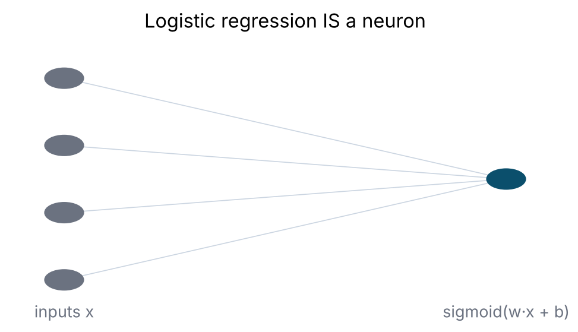
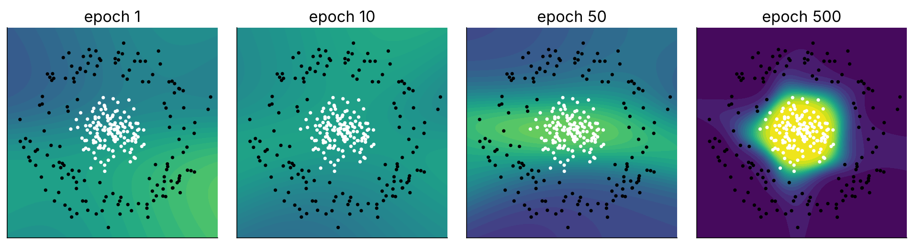
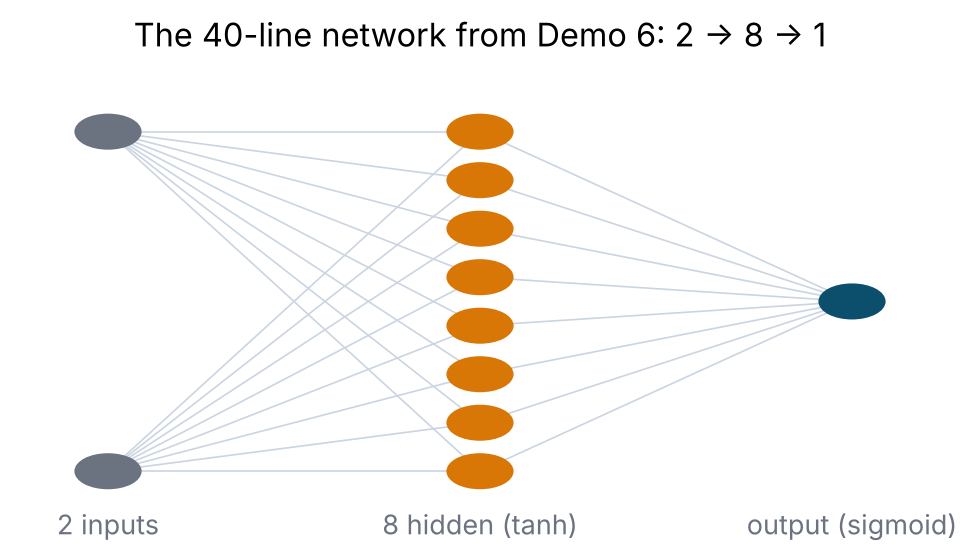
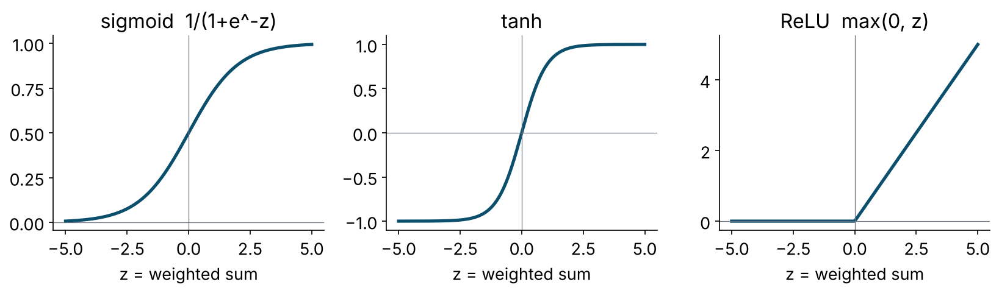
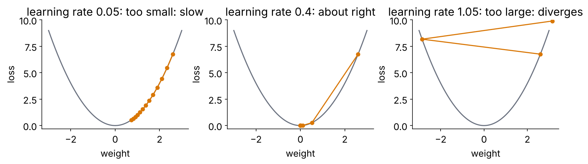

::: {.callout-note icon=false}
## What you will do

**Part A** is a reading: the theory of feed-forward neural networks from the logistic regression you already
own to backpropagation, worked by hand on a two-neuron network with real numbers. **Part B** builds that network
in 40 lines of base R so nothing is magic. **Part C** fits, regularises, tunes and explains a network in
tidymodels, adds a two-layer torch network, and closes with the verdict across all four families on one test set.

**Time:** lecture 55 min (Part A) · live coding 35 + 25 min (Parts B–C) · *Your turn* 25 min.
:::

# Part A · Theory primer

## A1 · You already own a neural network

Logistic regression computes a weighted sum of the inputs, adds a constant, and squashes the result into (0, 1):

$$
p \;=\; \sigma(z), \qquad z = w_1 x_1 + w_2 x_2 + \dots + w_p x_p + b, \qquad \sigma(z) = \frac{1}{1 + e^{-z}}.
$$

That object — *weighted sum → bias → non-linear squash* — is a **neuron** (or *unit*). $w$ are its **weights**,
$b$ its **bias**, $\sigma$ its **activation function**. Everything in deep learning is this unit, wired in
different ways and trained by the same procedure.

{fig-align="center" width="55%"}

Its limitation is geometric. The decision $p \ge 0.5$ is the same as $z \ge 0$, and $z = 0$ is a **straight line**
(a hyperplane in $p$ dimensions). One neuron can only draw one straight boundary.

## A2 · Why one neuron is not enough

Two classic problems defeat a straight line: **XOR** (positive when exactly one of two inputs is on) and the
**two rings** below. No weights $w_1, w_2, b$ exist that separate them. This is what Minsky and Papert pointed
out in 1969, and it shut the field down for fifteen years — until people trained the obvious fix.

{fig-align="center" width="100%"}

The fix: let several neurons each draw their own soft line, then let one more neuron **combine** those lines.

## A3 · The multilayer perceptron (MLP)

{fig-align="center" width="60%"}

Notation for one **hidden layer** of $H$ units and one output unit, for a single person with inputs
$\mathbf{x} \in \mathbb{R}^p$:

$$
\begin{aligned}
\mathbf{z}^{(1)} &= \mathbf{W}^{(1)\top} \mathbf{x} + \mathbf{b}^{(1)} &&\text{(hidden pre-activations, } H \text{ numbers)}\\
\mathbf{a}^{(1)} &= g\!\left(\mathbf{z}^{(1)}\right) &&\text{(hidden activations; } g \text{ applied element-wise)}\\
z^{(2)} &= \mathbf{W}^{(2)\top} \mathbf{a}^{(1)} + b^{(2)} &&\text{(output pre-activation, 1 number)}\\
p &= \sigma\!\left(z^{(2)}\right) &&\text{(predicted probability)}
\end{aligned}
$$

with $\mathbf{W}^{(1)}$ a $p \times H$ matrix, $\mathbf{b}^{(1)}$ a vector of $H$ biases, $\mathbf{W}^{(2)}$ a
vector of $H$ weights, $b^{(2)}$ one bias. For $n$ people at once, stack the inputs as rows of an $n \times p$
matrix $\mathbf{X}$ and everything becomes matrix multiplication — which is why GPUs matter and why the R code in
Part B is five lines.

**Parameter count:** $pH + H + H + 1$. For our data ($p \approx 45$) and $H = 30$: $45 \cdot 30 + 30 + 30 + 1 = 1{,}411$
free parameters, trained on ~3,200 people per fold. Hold that number — it explains Section A9.

**"Deep"** simply means more than one hidden layer: $\mathbf{a}^{(2)} = g(\mathbf{W}^{(2)\top}\mathbf{a}^{(1)} + \mathbf{b}^{(2)})$,
and so on. Each layer re-describes the previous one's output; depth lets the network compose simple features into
complex ones with far fewer units than one very wide layer would need.

### A worked forward pass (keep these numbers; we reuse them for backpropagation)

A tiny network: 2 inputs → 2 tanh hidden units → 1 sigmoid output. One person with $\mathbf{x} = (1.0,\, 0.5)$
who truly has the outcome ($y = 1$).

$$
\mathbf{W}^{(1)} = \begin{pmatrix} 0.5 & -0.3 \\ 0.2 & 0.8 \end{pmatrix},\quad
\mathbf{b}^{(1)} = (0.1,\; 0.1),\quad
\mathbf{W}^{(2)} = (0.7,\; -0.4),\quad b^{(2)} = 0.05
$$

| Step | Computation | Result |
|---|---|---|
| hidden pre-activations | $z^{(1)}_1 = 1.0(0.5) + 0.5(0.2) + 0.1$; $\;z^{(1)}_2 = 1.0(-0.3) + 0.5(0.8) + 0.1$ | $(0.70,\; 0.20)$ |
| hidden activations | $\tanh(0.70),\ \tanh(0.20)$ | $(0.6044,\; 0.1974)$ |
| output pre-activation | $0.7(0.6044) + (-0.4)(0.1974) + 0.05$ | $0.3941$ |
| prediction | $\sigma(0.3941)$ | $p = 0.5973$ |

The network says 60 % for someone who is a case. It should say more. Training is how it learns to.

## A4 · Activation functions: the non-linearity is the point

{fig-align="center" width="85%"}

| Function | Formula | Derivative | Range | Notes |
|---|---|---|---|---|
| sigmoid | $\sigma(z) = 1/(1+e^{-z})$ | $\sigma(z)(1-\sigma(z))$ | (0, 1) | output unit for binary outcomes; hidden units in `nnet`; saturates |
| tanh | $(e^{z}-e^{-z})/(e^{z}+e^{-z})$ | $1 - \tanh^2(z)$ | (−1, 1) | zero-centred sigmoid; our Part B network |
| ReLU | $\max(0, z)$ | $1$ if $z>0$ else $0$ | [0, ∞) | the default for hidden units in deep nets; cheap, no saturation on the positive side |
| leaky ReLU / ELU / GELU | small negative slope / smooth variants | — | — | fix "dead" ReLUs |
| softmax | $e^{z_k}/\sum_j e^{z_j}$ | — | probabilities over $K$ classes | output unit for multi-class |
| identity | $z$ | 1 | ℝ | output unit for regression |

Why it matters: **without a non-linear $g$, stacking layers does nothing** — a product of matrices is a matrix,
so the whole network collapses to one linear model. The squash is what lets eight neurons make a ring.

**Saturation.** Where sigmoid and tanh are flat (|z| large), their derivative is ≈ 0, so the gradient that
reaches earlier layers is ≈ 0 and they stop learning — the *vanishing-gradient* problem that made deep sigmoid
nets untrainable. ReLU's derivative is exactly 1 on the positive side, which is most of why 2012 happened.

## A5 · The loss: what "wrong" means

For binary classification the loss is **binary cross-entropy** (log-loss), averaged over the $n$ training people:

$$
L = -\frac{1}{n}\sum_{i=1}^{n}\Big[\, y_i \log p_i + (1-y_i)\log(1-p_i) \,\Big].
$$

This is exactly the negative log-likelihood that logistic regression maximises — nothing new. It punishes
confident wrong answers brutally ($p = 0.99$ when $y = 0$ costs 4.6; $p = 0.6$ costs 0.9), and it is smooth, so
it has a gradient everywhere. *Accuracy* has no gradient (a tiny weight change rarely flips a prediction), which
is why nothing is trained on accuracy directly. Regression uses mean squared error; multi-class uses categorical
cross-entropy; survival, ordinal and custom problems write their own.

For our worked example: $L = -\log(0.5973) = 0.5154$.

## A6 · Gradient descent: walking downhill

Training = find the weights that minimise $L$. There is no closed form, so we iterate:

$$
\theta \;\leftarrow\; \theta - \eta \,\frac{\partial L}{\partial \theta}
\qquad\text{for every weight and bias } \theta,
$$

where $\eta$ is the **learning rate**. The gradient points uphill; we step the other way. Repeat for many
**epochs** (passes through the data).

{fig-align="center" width="90%"}

| Variant | Gradient computed on | Comment |
|---|---|---|
| batch gradient descent | all $n$ rows | exact; slow and memory-heavy for large $n$ (what Part B and `nnet` do) |
| stochastic (SGD) | one row at a time | noisy; the noise helps escape poor regions |
| **mini-batch** | 32–512 rows | the standard; one epoch = all mini-batches once (`brulee`, `keras`, `torch`) |
| momentum | running average of past gradients | rolls through flat regions; damps zig-zagging |
| **Adam / AdamW** | per-weight adaptive step + momentum | the default optimiser in most deep learning |
| L-BFGS | quasi-Newton (uses curvature) | excellent for small networks; `nnet` and `brulee`'s default |

A learning-rate **schedule** (start higher, decay; or cyclic) often matters more than the choice of optimiser.

## A7 · Backpropagation is the chain rule

We need $\partial L / \partial \theta$ for every weight. Backpropagation computes them all in one backward sweep by
applying the chain rule layer by layer, **reusing** each layer's result for the layer before it. For one person
(drop the $1/n$):

**Output layer.** With sigmoid output and cross-entropy loss, a small miracle:
$$
\delta^{(2)} \equiv \frac{\partial L}{\partial z^{(2)}} = p - y .
$$
*How wrong, with a sign.* For our example: $\delta^{(2)} = 0.5973 - 1 = -0.4027$.

Then, because $z^{(2)} = \sum_h W^{(2)}_h a^{(1)}_h + b^{(2)}$:
$$
\frac{\partial L}{\partial W^{(2)}_h} = \delta^{(2)}\, a^{(1)}_h, \qquad
\frac{\partial L}{\partial b^{(2)}} = \delta^{(2)} .
$$
Example: $\partial L/\partial W^{(2)} = -0.4027 \times (0.6044,\ 0.1974) = (-0.2434,\ -0.0795)$;
$\partial L/\partial b^{(2)} = -0.4027$.

**Pass the blame back.** How much did each hidden activation contribute to the error?
$$
\frac{\partial L}{\partial a^{(1)}_h} = \delta^{(2)}\, W^{(2)}_h
\quad\Rightarrow\quad (-0.4027)(0.7,\ -0.4) = (-0.2819,\ 0.1611).
$$

**Through the activation.** $a^{(1)}_h = \tanh(z^{(1)}_h)$, so multiply by $\tanh'(z) = 1 - a^2$:
$$
\delta^{(1)}_h \equiv \frac{\partial L}{\partial z^{(1)}_h} = \frac{\partial L}{\partial a^{(1)}_h}\,(1 - (a^{(1)}_h)^2)
\quad\Rightarrow\quad (-0.2819)(0.6347),\ (0.1611)(0.9610) = (-0.1789,\ 0.1548).
$$

**Input weights.** Because $z^{(1)}_h = \sum_j W^{(1)}_{jh} x_j + b^{(1)}_h$:
$$
\frac{\partial L}{\partial W^{(1)}_{jh}} = \delta^{(1)}_h\, x_j, \qquad \frac{\partial L}{\partial b^{(1)}_h} = \delta^{(1)}_h .
$$
Example: $\partial L / \partial \mathbf{W}^{(1)} = \begin{pmatrix} 1.0 \\ 0.5 \end{pmatrix}(-0.1789,\ 0.1548) =
\begin{pmatrix} -0.1789 & 0.1548 \\ -0.0895 & 0.0774 \end{pmatrix}$.

**One gradient-descent step** with $\eta = 0.5$ ($\theta \leftarrow \theta - 0.5\,\partial L/\partial\theta$):

$$
\mathbf{W}^{(1)} \to \begin{pmatrix} 0.5895 & -0.3774 \\ 0.2447 & 0.7613 \end{pmatrix},\quad
\mathbf{b}^{(1)} \to (0.1895,\ 0.0226),\quad
\mathbf{W}^{(2)} \to (0.8217,\ -0.3603),\quad b^{(2)} \to 0.2514 .
$$

Run the forward pass again with the new weights: $p = 0.6966$, loss $0.3615$ (was 0.5154). The network moved
toward the right answer for this person. Do that for all $n$ people (average the gradients), thousands of times,
and it has *learned*. That is all "learning" means here: the numbers in $\mathbf{W}$ changed.

::: {.callout-tip}
## In matrix form, for $n$ people (this is Part B's code)
$\;\boldsymbol{\delta}^{(2)} = (\mathbf{P} - \mathbf{y})/n$ ·
$\;\nabla_{\mathbf{W}^{(2)}} = \mathbf{A}^{(1)\top}\boldsymbol{\delta}^{(2)}$ ·
$\;\boldsymbol{\delta}^{(1)} = \big(\boldsymbol{\delta}^{(2)}\mathbf{W}^{(2)\top}\big) \odot (1 - \mathbf{A}^{(1)2})$ ·
$\;\nabla_{\mathbf{W}^{(1)}} = \mathbf{X}^\top \boldsymbol{\delta}^{(1)}$ ·
biases are column sums of the $\boldsymbol{\delta}$s.
:::

Deep-learning frameworks (torch, TensorFlow, JAX) do this **automatically** for any architecture — *automatic
differentiation*. You write the forward pass; they derive the backward pass. The maths does not change.

```{r}
#| label: worked-example-check
#| code-fold: true
#| code-summary: "Check the worked example in R"
sigmoid <- function(z) 1 / (1 + exp(-z))
x <- c(1, 0.5); y <- 1
W1 <- matrix(c(0.5, 0.2, -0.3, 0.8), nrow = 2); b1 <- c(0.1, 0.1); W2 <- c(0.7, -0.4); b2 <- 0.05
z1 <- as.vector(x %*% W1) + b1; a1 <- tanh(z1); z2 <- sum(W2 * a1) + b2; p <- sigmoid(z2)
c(z1 = z1, a1 = a1, z2 = z2, p = p, loss = -log(p))
d2 <- p - y; dW2 <- d2 * a1; db2 <- d2
d1 <- (d2 * W2) * (1 - a1^2); dW1 <- outer(x, d1); db1 <- d1
list(dW2 = dW2, dW1 = dW1)
lr <- 0.5
W1 <- W1 - lr * dW1; b1 <- b1 - lr * db1; W2 <- W2 - lr * dW2; b2 <- b2 - lr * db2
z1 <- as.vector(x %*% W1) + b1; a1 <- tanh(z1); p_new <- sigmoid(sum(W2 * a1) + b2)
c(p_after_one_step = p_new, loss_after = -log(p_new))
```

## A8 · Making training work: initialisation and gradient flow

- **Initialisation.** Weights start small and random (never all zero — identical units would receive identical
  gradients and never differentiate). Modern schemes (Xavier/Glorot for tanh, He for ReLU) scale the randomness to
  the number of inputs so activations neither explode nor vanish layer by layer. Different seeds → slightly
  different networks; report that.
- **Vanishing / exploding gradients.** Each backward step multiplies by a weight and an activation derivative.
  Products of many small numbers → 0 (deep sigmoid nets stall); of many large ones → ∞ (training diverges). Fixes:
  ReLU, good initialisation, **gradient clipping**, **batch normalisation** (standardise each layer's inputs during
  training), **residual connections** (let a layer learn a *correction* to its input rather than a full transform).
- **Scaling the inputs is not optional.** Gradient descent on `hh_income` in ringgit and `age` in years will spend
  all its steps on income. `step_normalize()`.

## A9 · Capacity, overfitting and the brakes

A network with 1,411 parameters on 3,200 people will, left alone, drive the training loss toward zero by
memorising — validation AUC falls, probabilities pile up at 0 and 1. The regularisers:

| Brake | Mechanism | parsnip / brulee |
|---|---|---|
| **weight decay (L2)** | add $\lambda\sum\theta^2$ to the loss, so the gradient step also shrinks every weight toward 0: the network's ridge regression | `penalty` |
| **dropout** | during training, silence a random fraction of hidden units on every step; at test time use all of them, scaled. Forces redundancy; approximates an ensemble | `dropout` (brulee) |
| **early stopping** | watch a validation slice; stop when its loss has not improved for *k* epochs | `brulee`: `stop_iter`, `validation` |
| smaller architecture | fewer units / layers | `hidden_units` |
| batch normalisation | stabilises and mildly regularises | brulee option |
| data augmentation | more (perturbed) training examples | images, audio |

Rules of thumb: always use early stopping when you can; use weight decay **or** dropout (brulee asks you not to
combine them); tune width and decay together — they trade off.

## A10 · Architecture choices for tabular data

- **Width:** 8–64 hidden units for a few thousand rows; the data, not the problem, set the ceiling.
- **Depth:** one hidden layer is usually enough for tabular data; two (e.g. 32 → 16) occasionally helps; more
  rarely does.
- **Activation:** ReLU for depth; tanh/sigmoid fine for one small layer (`nnet`).
- **Output:** sigmoid + cross-entropy for binary; softmax for multi-class; identity + MSE for regression. parsnip
  sets this from `set_mode()`.
- **Hyperparameters that matter, in order:** learning rate (if not L-BFGS) → width → weight decay/dropout →
  epochs (with early stopping) → batch size → depth.

**Universal approximation** (Cybenko 1989; Hornik 1991): one hidden layer with enough units can approximate any
continuous function on a bounded domain. "Enough" can be astronomically many; depth achieves the same with far
fewer parameters. The theorem says a network *can* represent the truth, not that gradient descent will *find* it
or that your 3,200 people will *identify* it.

## A11 · Beyond the MLP (what "deep learning" adds)

| Architecture | Core idea | Health examples |
|---|---|---|
| **Convolutional network (CNN)** | a small filter (3 × 3 weights) slides over the image, firing where it matches a pattern; layers of filters build edges → textures → parts → objects; pooling shrinks and adds translation invariance | fundus photos (diabetic retinopathy), chest X-ray triage, pathology slides, dermatology, 1-D CNNs on ECG |
| **Recurrent network (RNN, LSTM, GRU)** | processes a sequence step by step, carrying a hidden state (memory); LSTM gates control what to keep | ECG/EEG, vital-sign streams, early sequence models of EHR visits |
| **Transformer / attention** | every position looks at every other position and learns *where to look*; no recurrence, massively parallel; the basis of BERT/GPT and modern vision models | clinical notes, coding, EHR trajectories, foundation models for imaging and text |
| **Autoencoder** | compress to a bottleneck and reconstruct; learns a low-dimensional representation | denoising, anomaly detection, phenotype discovery |
| **Transfer learning** | start from a network trained on millions of natural images or documents; retrain only the last layers on your 2,000 examples | how small medical imaging datasets get state-of-the-art results |

The common thread: the inputs are **raw and high-dimensional** (pixels, waveforms, tokens) and the useful features
must be *learned*. Tabular survey data already arrives feature-engineered — which is why trees do so well on it.

## A12 · When neural networks lose: the evidence on tabular data

| Study | Finding |
|---|---|
| Shwartz-Ziv & Armon 2022, *Information Fusion* — "Tabular data: deep learning is not all you need" | XGBoost beat the deep tabular models on the datasets those models were published with |
| Grinsztajn, Oyallon & Varoquaux 2022, NeurIPS — "Why do tree-based models still outperform deep learning on tabular data?" | 45 datasets: tuned GBMs win on medium-sized tabular data; nets struggle with uninformative features and non-smooth targets |
| McElfresh et al. 2023, NeurIPS — "When do neural nets outperform boosted trees on tabular data?" | 176 datasets: for most, the gap is smaller than the gain from tuning; nets win on some large, smooth problems |
| Christodoulou et al. 2019, *J Clin Epidemiol* | no performance benefit of ML over logistic regression across 71 clinical prediction studies, after accounting for bias |

On 5,000 rows of survey data a well-regularised network **ties** boosted trees and logistic regression — and costs
more compute, more tuning, more run-to-run variance and less interpretability. Part C shows exactly that. It is a
finding, not a failure. Where networks earn their keep is A11.

## A13 · How deep learning fails in health (same medicine as Day 1)

**Shortcut learning** (the pneumonia classifier that read the portable-X-ray marker; COVID chest X-ray models that
learned the hospital — DeGrave et al. 2021), **dataset shift** (a new scanner, a new population), **over-confidence**
(deep nets are badly calibrated out of the box — Guo et al. 2017; recalibrate), **data and label hunger**,
**reproducibility** (seeds, GPU non-determinism), **equity** (under-performance on under-represented skin tones,
sexes, ethnicities unless measured). Leak-free splits by *patient*, honest resampling, calibration, subgroup checks,
and explanations used as audits — the whole workshop applies unchanged.

## A14 · Glossary

| Term | Meaning |
|---|---|
| unit / neuron | weighted sum + bias + activation |
| layer | a set of units fed by the same inputs; input, hidden, output |
| weights, biases, parameters | the numbers learned by training |
| hyperparameters | width, depth, learning rate, decay, dropout, epochs, batch size — set before training, tuned by CV |
| activation | the non-linear squash ($\sigma$, tanh, ReLU) |
| logit / pre-activation | the weighted sum before the squash |
| loss | the number training minimises (cross-entropy, MSE) |
| epoch | one pass through the training data |
| batch / mini-batch | the rows used for one gradient step |
| learning rate | step size of gradient descent |
| backpropagation | the chain-rule algorithm that computes all gradients in one backward sweep |
| weight decay | L2 penalty on the weights (`penalty`) |
| dropout | random silencing of units during training |
| early stopping | stop when validation loss stops improving |
| embedding | a learned dense vector for a categorical token (words, diagnosis codes) |

# Part B · A network from scratch (base R, no packages)

```{r}
#| label: setup
# WHERE WE ARE ---------------------------------------------------------------------------------------------
# Part A was theory and Part B a network written from scratch in base R. Now the fourth family joins the same
# pipeline: the SAME R/prep_nhms.R objects, the SAME dm_folds and cls_metrics, the SAME tune()/racing idiom from
# T5, the SAME SHAP code from T6. C6 is the cumulative verdict: logistic baseline, RF (T2), SVM (T3), tuned
# XGBoost (T5, loaded from outputs/) and the tuned network on the one held-out test set.
source("R/prep_nhms.R")
library(finetune)
library(kernelshap)
library(shapviz)
library(patchwork)
library(future)
plan(multisession, workers = max(1, parallel::detectCores() - 1))
dir.create("outputs", showWarnings = FALSE)
```

## B1 · A problem a straight line cannot solve

```{r}
#| label: toy
set.seed(42)
n  <- 300
r  <- c(runif(n / 2, 0, 1.0), runif(n / 2, 1.6, 2.6))
th <- runif(n, 0, 2 * pi)
X  <- cbind(r * cos(th), r * sin(th)) + matrix(rnorm(2 * n, 0, 0.15), n, 2)
y  <- matrix(c(rep(1, n / 2), rep(0, n / 2)), ncol = 1)
toy <- tibble(x1 = X[, 1], x2 = X[, 2], class = factor(ifelse(y == 1, "inner", "outer"), levels = c("inner", "outer")))

ggplot(toy, aes(x1, x2, colour = class)) + geom_point(size = 2) + coord_equal() + theme_minimal() +
  labs(title = "Can one straight line separate these?")

glm_toy <- glm(class ~ x1 + x2, data = toy, family = binomial)
mean((predict(glm_toy, type = "response") > 0.5) == (toy$class == "outer"))    # logistic regression: a coin flip
```

## B2 · The network: 2 inputs → 8 tanh units → 1 sigmoid output

```{r}
#| label: scratch-net
sigmoid <- function(z) 1 / (1 + exp(-z))
H  <- 8          # hidden units
lr <- 0.5        # learning rate

set.seed(1)
W1 <- matrix(rnorm(2 * H, sd = 0.5), nrow = 2, ncol = H); b1 <- rep(0, H)   # input  -> hidden
W2 <- matrix(rnorm(H, sd = 0.5), nrow = H, ncol = 1);     b2 <- 0           # hidden -> output

forward <- function(X, W1, b1, W2, b2) {
  Z1 <- sweep(X %*% W1, 2, b1, "+")   # weighted sums, hidden layer         (n x H)
  A1 <- tanh(Z1)                       # activation - this is what bends the boundary
  Z2 <- A1 %*% W2 + b2                 # weighted sum, output                (n x 1)
  P  <- sigmoid(Z2)                    # probability of "inner"
  list(A1 = A1, P = P)
}

loss_hist <- numeric(0); snapshots <- list()
for (epoch in 1:500) {
  fw <- forward(X, W1, b1, W2, b2); P <- fw$P; A1 <- fw$A1
  loss_hist[epoch] <- -mean(y * log(P + 1e-9) + (1 - y) * log(1 - P + 1e-9))   # cross-entropy (A5)

  # BACKPROPAGATION (A7), in matrix form
  dZ2 <- (P - y) / n                   # delta at the output
  dW2 <- t(A1) %*% dZ2;  db2 <- sum(dZ2)
  dA1 <- dZ2 %*% t(W2)                 # pass the blame back through W2
  dZ1 <- dA1 * (1 - A1^2)              # through tanh (derivative 1 - a^2)
  dW1 <- t(X) %*% dZ1;   db1 <- colSums(dZ1)

  # GRADIENT DESCENT (A6)
  W1 <- W1 - lr * dW1; b1 <- b1 - lr * db1
  W2 <- W2 - lr * dW2; b2 <- b2 - lr * db2

  if (epoch %in% c(1, 10, 50, 500)) snapshots[[as.character(epoch)]] <- list(W1 = W1, b1 = b1, W2 = W2, b2 = b2)
}

tibble(epoch = seq_along(loss_hist), loss = loss_hist) |>
  ggplot(aes(epoch, loss)) + geom_line(linewidth = 1) + theme_minimal() +
  labs(title = "Training loss: gradient descent walking downhill")
```

## B3 · Watch the boundary bend

```{r}
#| label: boundary
#| fig-width: 12
#| fig-height: 3.6
grid_xy <- expand_grid(x1 = seq(-3, 3, by = 0.05), x2 = seq(-3, 3, by = 0.05))
boundary_at <- function(ep) {
  s <- snapshots[[ep]]
  grid_xy |>
    mutate(p = as.vector(forward(as.matrix(grid_xy), s$W1, s$b1, s$W2, s$b2)$P)) |>
    ggplot(aes(x1, x2)) +
    geom_raster(aes(fill = p)) +
    geom_point(data = toy, aes(colour = class), size = 1, show.legend = FALSE) +
    scale_fill_viridis_c(limits = c(0, 1), name = "P(inner)") +
    scale_colour_manual(values = c("white", "black")) +
    coord_equal() + theme_minimal() + labs(title = paste("epoch", ep))
}
boundary_at("1") + boundary_at("10") + boundary_at("50") + boundary_at("500") + plot_layout(guides = "collect")

fw <- forward(X, W1, b1, W2, b2)
mean((fw$P > 0.5) == (y == 1))        # accuracy after 500 epochs
```

Eight neurons, each drawing one soft line; the output neuron combines them into a ring. **Where is the learning?**
In the numbers in `W1` and `W2` — nowhere else. "Deep" means more layers of this; everything else in deep
learning is engineering around getting the gradient to behave.

# Part C · Neural networks in tidymodels

## C1 · `mlp()` with the `nnet` engine

`nnet` ships with R: one hidden layer of sigmoid units, trained with BFGS on the full batch. Inputs must be
numeric and scaled — `dm_rec` does both. The same six verbs as every other model.

```{r}
#| label: nnet
nn_spec <- mlp(hidden_units = 8, penalty = 0.01, epochs = 200) |>
  set_engine("nnet", MaxNWts = 10000) |>      # raise nnet's default cap of 1,000 weights
  set_mode("classification")
# penalty = weight decay (A9); epochs = maximum optimiser iterations

nn_wf <- workflow(dm_rec, nn_spec)

set.seed(2026)
nn_res <- fit_resamples(nn_wf, dm_folds, metrics = cls_metrics, control = control_resamples(save_pred = TRUE))
collect_metrics(nn_res)
```

## C2 · Under- and over-regularised

```{r}
#| label: nn-sweep
nn <- function(units, decay) mlp(hidden_units = units, penalty = decay, epochs = 200) |>
  set_engine("nnet", MaxNWts = 10000) |> set_mode("classification")

set.seed(2026)
nn_sweep <- workflow_set(
  preproc = list(base = dm_rec),
  models  = list(tiny_no_decay = nn(2, 0), big_no_decay = nn(30, 0), big_with_decay = nn(30, 0.05))
) |>
  workflow_map("fit_resamples", resamples = dm_folds, metrics = cls_metrics, seed = 2026)

collect_metrics(nn_sweep) |> filter(.metric %in% c("roc_auc", "brier_class")) |> select(wflow_id, .metric, mean, std_err)
```

Thirty units with no decay ≈ 1,400 free parameters on ~3,200 people: it memorises, and the Brier score shows the
over-confident probabilities. Add weight decay and it comes back. Regularisation is not optional for networks.

## C3 · Tune it like any other model

```{r}
#| label: nn-tune
nn_tune_wf <- workflow(dm_rec, mlp(hidden_units = tune(), penalty = tune(), epochs = 200) |>
                         set_engine("nnet", MaxNWts = 10000) |> set_mode("classification"))

nn_params <- extract_parameter_set_dials(nn_tune_wf) |>
  update(hidden_units = hidden_units(range = c(2L, 24L)),
         penalty      = penalty(range = c(-4, -0.5)))      # log10: 0.0001 .. 0.32

set.seed(2026)
nn_race <- tune_race_anova(nn_tune_wf, resamples = dm_folds, param_info = nn_params, grid = 16,
                           metrics = metric_set(roc_auc, brier_class), control = control_race(verbose_elim = TRUE))
show_best(nn_race, metric = "roc_auc", n = 5)
autoplot(nn_race, metric = "roc_auc") + theme_minimal()

nn_final_wf <- finalize_workflow(nn_tune_wf, select_best(nn_race, metric = "roc_auc"))
nn_last     <- last_fit(nn_final_wf, dm_split, metrics = cls_metrics)
collect_metrics(nn_last)
nn_fit <- extract_workflow(nn_last)
saveRDS(nn_last, "outputs/t07_nn_last.rds")
```

Expect more run-to-run variability than trees (random initialisation); repeated CV earns its keep for networks.

## C4 · Deeper, with torch: the `brulee` engine *(only if torch is installed — see Setup)*

::: {.callout-warning}
## One torch quirk, so it does not frighten you
Once torch has been loaded, **Session › Restart R** can end with "R Session Aborted — R encountered a fatal error"
(a known torch-on-Windows issue when its libraries are unloaded). Nothing is lost: click *Start New Session*.
If you need a clean session after this part, close RStudio and reopen the project instead of restarting R.
:::

```{r}
#| label: brulee
torch_ok <- requireNamespace("brulee", quietly = TRUE) && requireNamespace("torch", quietly = TRUE) &&
  tryCatch(torch::torch_is_installed(), error = function(e) FALSE)
torch_ok
```

```{r}
#| label: brulee-fit
if (torch_ok) {
  # two hidden layers (32 -> 16), ReLU, dropout, mini-batch SGD with momentum, early stopping on a 10% validation slice
  deep_spec <- mlp(hidden_units = c(32L, 16L), epochs = 150, learn_rate = 0.005, dropout = 0.2, penalty = 0,
                   activation = "relu") |>
    set_engine("brulee", optimizer = "SGD", batch_size = 256, momentum = 0.9, stop_iter = 15, validation = 0.1) |>
    set_mode("classification")

  set.seed(2026)
  deep_fit <- workflow(dm_rec, deep_spec) |> fit(dm_train)
  print(deep_fit |> extract_fit_engine() |> autoplot() + theme_minimal() +
          labs(title = "brulee: validation loss by epoch (early stopping)"))
  print(augment(deep_fit, dm_test) |> cls_metrics(truth = undx_dm, estimate = .pred_class, .pred_Yes))
} else {
  message("torch is not installed on this machine - skipping the brulee network (see Setup). Nothing below depends on it.")
}
```

This is what people mean by "deep learning", at toy scale: layers, ReLU, dropout, mini-batches, momentum, early
stopping — each word a fix for a specific way training goes wrong (A8–A9). On 4,000 rows of tabular data it is
**not** better than `nnet`, XGBoost or logistic regression — the published result (A12).

## C5 · Explain the network with this morning's plots

There is no TreeSHAP for a network, so this is where **KernelSHAP** earns its keep: it estimates the Shapley values
from predictions alone, for any model. Two things keep it affordable. First, explain a *sample* of people against a
small *background* sample — cost grows with rows × background × the number of rounds it needs to converge, and a
network needs more rounds than a tree ensemble. Second, hand it the **baked** matrix and the bare model, not the
whole workflow: every one of the thousands of prediction calls would otherwise re-run the recipe. As this morning,
`collapse` adds each factor's dummy columns back together and `X` supplies the original values for the plots.

```{r}
#| label: nn-shap
set.seed(2026)
X_explain <- dm_train |> select(-undx_dm) |> slice_sample(n = 60)           # people to explain (KernelSHAP is the one slow chunk - keep it small)
X_bg      <- dm_train |> select(-undx_dm) |> slice_sample(n = 30)           # background ("what a typical person looks like")

rec_fit  <- extract_recipe(nn_fit)                                          # trained recipe
nn_model <- extract_fit_parsnip(nn_fit)                                     # bare model: predicts on BAKED data
X_baked  <- bake(rec_fit, new_data = X_explain, all_predictors())
bg_baked <- bake(rec_fit, new_data = X_bg,      all_predictors())
pred_yes_baked <- function(model, newdata, ...) predict(model, new_data = newdata, type = "prob")$.pred_Yes

dummy_step <- tidy(rec_fit) |> filter(type == "dummy") |> pull(number)
facs       <- tidy(rec_fit, number = dummy_step) |> pull(terms) |> unique()   # the original factor columns
# each factor -> the dummy columns it produced. bake() cleans the level names (25-29.9 -> X25.29.9), so match on
# the "<factor>_" prefix of the ACTUAL baked columns rather than on the raw level names.
collapse   <- setNames(lapply(facs, \(f) grep(paste0("^", f, "_"), colnames(X_baked), value = TRUE)), facs)
collapse   <- collapse[lengths(collapse) > 0]

t_shap <- system.time(
  ks_nn <- kernelshap(nn_model, X = X_baked, bg_X = bg_baked, pred_fun = pred_yes_baked, verbose = FALSE)
)
t_shap[["elapsed"]]                                                         # seconds

sv_nn <- shapviz(ks_nn, X = X_explain, collapse = collapse)
sv_importance(sv_nn, kind = "beeswarm", max_display = 15) + labs(title = "SHAP: tuned neural network")
sv_dependence(sv_nn, v = "bmi", color_var = "fam_hx_dm") + labs(title = "Network: BMI x family history")
```

Does the network find the same structure the trees found this morning? Agreement across two very different model
families is evidence the structure is in the **data**, not an artefact of one algorithm.

## C6 · The verdict: four families, one test set

```{r}
#| label: verdict
lr_last  <- last_fit(workflow(dm_rec, logistic_reg() |> set_engine("glm")), dm_split, metrics = cls_metrics)
rf_last  <- last_fit(workflow(dm_rec, rand_forest(trees = 500, mtry = 6, min_n = 10) |> set_engine("ranger") |> set_mode("classification")), dm_split, metrics = cls_metrics)
svm_last <- last_fit(workflow(dm_rec, svm_rbf(cost = 1, rbf_sigma = 0.005) |> set_engine("kernlab") |> set_mode("classification")), dm_split, metrics = cls_metrics)
xgb_last <- if (file.exists("outputs/t05_xgb_last.rds")) readRDS("outputs/t05_xgb_last.rds") else NULL

verdict <- bind_rows(
  logistic_baseline = collect_metrics(lr_last),
  random_forest     = collect_metrics(rf_last),
  svm_rbf           = collect_metrics(svm_last),
  xgboost_tuned     = if (!is.null(xgb_last)) collect_metrics(xgb_last) else NULL,
  neural_net_tuned  = collect_metrics(nn_last),
  .id = "model"
) |>
  select(model, .metric, .estimate) |>
  pivot_wider(names_from = .metric, values_from = .estimate) |>
  arrange(desc(roc_auc))
verdict
saveRDS(verdict, "outputs/t07_verdict.rds")
```

A spread of a few hundredths of AUC across four model families. The data, the cleaning and the leakage audit moved
the needle by 0.1–0.5. Choose the model you can explain, calibrate and deploy.

## Your turn (25 min)

::: {.callout-tip icon=false}
## Task A · Count the parameters, then watch them overfit
1. How many weights does `nn(40, 0)` have? (inputs × hidden + hidden + hidden + 1; inputs = columns out of
   `dm_rec`.) How many people are in a training fold?
2. Resample `nn(4, 0.01)`, `nn(40, 0)` and `nn(40, 0.05)` in one `workflow_set()`. Which has the worst Brier
   score, and why does weight decay fix it?
:::

::: {.callout-note collapse="true"}
## Solution A

```{r}
#| label: solA
n_in <- dm_rec |> prep() |> bake(new_data = NULL) |> select(-undx_dm) |> ncol()
c(inputs = n_in, weights = n_in * 40 + 40 + 40 + 1, people_per_fold = round(nrow(dm_train) * 4 / 5))

set.seed(2026)
nn_three <- workflow_set(preproc = list(base = dm_rec),
                         models = list(small = nn(4, 0.01), big_free = nn(40, 0), big_decay = nn(40, 0.05))) |>
  workflow_map("fit_resamples", resamples = dm_folds, metrics = cls_metrics, seed = 2026)
collect_metrics(nn_three) |> filter(.metric %in% c("roc_auc", "brier_class")) |> select(wflow_id, .metric, mean, std_err)
```

About 1,900 weights for ~3,200 people — under two people per parameter. `big_free` has the worst Brier: it
produces over-confident probabilities near 0 and 1 for the wrong people. Weight decay shrinks the weights so the
network cannot build extreme logits out of noise — the same idea as ridge regression.
:::

::: {.callout-tip icon=false}
## Task B · Does it see the same world?
Compare the top-8 SHAP features of `sv_nn` with the XGBoost beeswarm from Tutorial 6. Where they agree, what
does that buy you? Where they disagree, which do you believe, and how would you find out?
:::

::: {.callout-note collapse="true"}
## Solution B
Agreement on age, BMI/waist, family history and ethnicity across two unrelated model families is evidence the
structure is real. Disagreement on minor features is usually noise: refit both on bootstrap resamples and see
whether the ranking is stable before telling a story about it.
:::

::: {.callout-tip icon=false}
## Task C · Stretch (needs torch)
1. Change `activation` in `deep_spec` to `"tanh"` and to `"elu"`. Does anything change on this data? Why so little?
2. Set `dropout = 0` and `penalty = 0.01` instead. Compare the loss curves (`autoplot()`): which stops earlier?
3. Try `hidden_units = c(64L, 32L, 16L)`. Better, worse, or the same — and what does that tell you about the data,
   not the network?
:::

::: {.callout-note collapse="true"}
## Solution C (discussion)
1. Barely anything: with one or two small layers and scaled inputs, the activation shape is not the binding
   constraint — the amount of signal in 4,000 rows is. 2. Weight decay typically trains more smoothly and stops a
   little later; dropout's noisier loss curve is normal. 3. The same within noise, slower, more variable: the extra
   capacity has nothing to learn. On tabular data of this size, capacity is not the bottleneck; information is.
:::

## Take-home challenge: who has undiagnosed hypertension?

Half of Malaysian adults with hypertension do not know it. Build a **community screening tool** for `undx_hpt`
with budget to measure the blood pressure of **one adult in three**. Everything you need is in Tutorials 1–7:

1. Leakage audit (`sys` and `dys` *define* the outcome; what else goes?).
2. Stratified split, five folds, recipe.
3. Bake-off: logistic, random forest, SVM, XGBoost, `mlp()` — same folds.
4. Race-tune the winner; one-SE rule.
5. Threshold that flags one in three, chosen on CV predictions; sensitivity, PPV and number-needed-to-measure on
   the test set, once.
6. Calibration plot; SHAP beeswarm; one dependence plot (try `age` coloured by `sex`).
7. Two caveats (prevalence shift; synthetic data).

Expected honest AUC ≈ 0.81–0.83. If you see 0.95, go back to step 1. The simulator's truth is in
`data-raw/simulate_nhms_synthetic.py` — read it *after* you have finished, and check whether your SHAP plots found
the interactions it planted.

## What to remember

1. A neuron = weighted sum + non-linear squash. Logistic regression is one neuron. A hidden layer bends the line.
2. Training = gradient descent on a loss; backpropagation is the chain rule, layer by layer, reusing each result.
3. Networks overfit by default; weight decay, dropout and early stopping are the brakes; scaled inputs are mandatory.
4. `mlp()` + `nnet`: tune width and decay like any other parsnip model; `brulee` for depth.
5. On small tabular data networks tie boosted trees and lose on cost. They win on images, signals, text, sequences.
